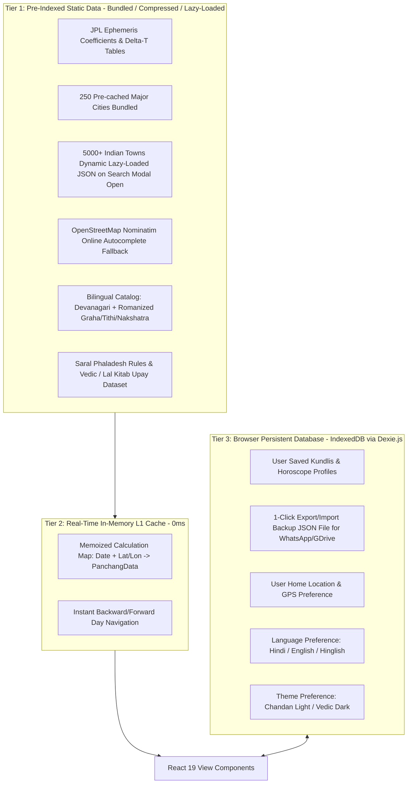
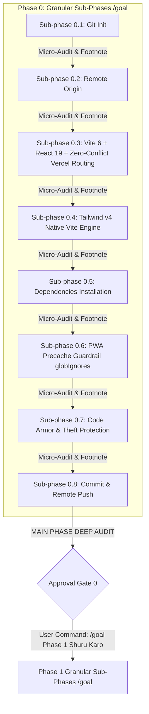

# 🏛️ SANATAN GHADI (सनातन घड़ी): MASTER ARCHITECTURE & PRODUCT SPECIFICATION
### Tagline: आधुनिक वैदिक पंचांग, चौघड़िया, जन्म कुंडली एवं कालगणना
**Official Brand Name:** Sanatan Ghadi (सनातन घड़ी)  
**Version:** 19.0 (Sanatan Ghadi Brand Identity, Codex Handover Milestone & 13-Hub Visual Benchmark Edition)  
**Target Directory:** `d:\Sanatan Web`  
**Living Plan File:** `d:\Sanatan Web\SANATAN_WEB_MASTER_ARCHITECTURE_PLAN.md`  
**Visual Benchmark Suite:** `d:\Sanatan Web\UI sample\` (13 Official Page Mockups)  
**GitHub Remote:** `https://github.com/vinayaksaxena1-maker/Sanatan-Web`  
**Tech Stack:** React 19 · Vite 6 · Tailwind CSS 4 · TypeScript · Lucide React · AstroEngine v2.0 (NASA JPL Bridge) · Web Workers · D3.js · Dexie.js (IndexedDB) · vite-plugin-pwa · Vercel Edge

---

## 1. Executive Summary & Skill Pipeline Alignment

```
[Phase 1: Planning & Architecture] ──> [Phase 2: Vedic Math Engine] ──> [Phase 3: Elite UI/UX & Mobile]
   • concise-planning                     • vedic-astronomy-math               • ui-ux-pro-max
   • graphify                             • AstroEngine Facade                 • mobile-design
                                          • Engine Audit Sandbox               • component-state-craftsman
                                                                                           │
[Phase 5: Marketing / Launch]      <── [Phase 4: Web Framework & Testing] <────────────────┘
   • brag / brag-slim                     • web-best-practices
                                          • puppeteer (MCP Web Testing)
                                          • systematic-debugging
```

**Sanatan Ghadi (सनातन घड़ी)** ek modern, ultra-fast, 100% offline-ready aur ad-free Vedic Panchang, Jyotish, Kundli, Choghadiya aur Kaalganana platform hai. Yeh Drik Panchang aur AstroSage ke sabhi features ko ek sath laakar, bina kisi ad ke, saral shuddh bhasha aur world-class UI me pradan karta hai.

---

## 2. Approved Architectural Baselines

| Decision Point | Approved Status | Rationale & Implementation Details |
| :--- | :---: | :--- |
| **Brand Identity** | **Sanatan Ghadi (सनातन घड़ी) (APPROVED)** | Official Name: `Sanatan Ghadi (सनातन घड़ी)`; Tagline: *आधुनिक वैदिक पंचांग, चौघड़िया, जन्म कुंडली एवं कालगणना*; PWA Name: *'सनातन घड़ी'*; Social/PNG Branding: *'सनातन घड़ी (Sanatan Ghadi)'*. |
| **Living Source of Truth (SSOT)**| **Project-Root Tracked & Progressively Updated (APPROVED)** | `d:\Sanatan Web\SANATAN_WEB_MASTER_ARCHITECTURE_PLAN.md` repo me live rahega. Har sub-phase complete hone par isme status `[COMPLETED ✅]` aur git commit hash update hoga taaki koi bhi naya AI/developer bina context loss ke kaam aage badha sake. |
| **Calculation Engine** | **Option B: `AstroEngine_v_2.0` (APPROVED)** | Clean-room MIT license, zero WASM bloat (~180 KB JS vs 12 MB WASM), 7.41 ms latency, 1,902 passing tests, pure TypeScript. |
| **Engine Location** | **Self-Contained Inside Repo (APPROVED)** | `D:\AstroEngine_v_2.0\src` ko direct `d:\Sanatan Web\src\engine\` me copy kiya jayega taaki ek hi Git repository me poora project self-contained rahe. |
| **Platform Form Factor** | **Pure Website + PWA (APPROVED)** | Universal responsive web application. PWA capabilities se zero-install offline "Add to Home Screen". No Capacitor APK overhead. |
| **PWA Lifecycle & Shield**| **Two-Stage + Precache Guardrail (APPROVED)** | Stage 1 (Initial online warm-up) $\rightarrow$ Stage 2 (100% offline flight mode). Workbox `globIgnores` ensures precache stays strictly ~1.5 MB. |
| **City Coverage Scale** | **250 Major Bundled + 5,000+ Towns Lazy-Loaded (APPROVED)** | 250 major cities bundled; 5,000+ Indian towns JSON dynamically loaded (`import()`) only on search modal open; OSM Nominatim live fallback. |
| **Language & Script** | **Devanagari-First Multilingual i18n (APPROVED)** | Shuddh Hindi (Devanagari) default + English + Hinglish switcher; sabhi Graha, Tithi, Nakshatra, Yoga dono lipiyon me encoded. |
| **Theological Moats** | **Ekadashi Parana & Moonrise Engines (APPROVED)** | Udaya Tithi rules, Smarta vs Vaishnava dual vrata nirnaya, `calculateEkadashiParana()`, `calculateHariVasaraEnd()`, and city-wise `calculateMoonrise()`. |
| **Astrology Guidance** | **Saral Phaladesh & Vedic/Lal Kitab Upay (APPROVED)** | D1-D60 aur Shadbala ke sath-sath aam insaan ke liye Career, Vivah, Dhan aur Swasthya ka saral phalit aur kargar upaay (remedies). |
| **Viral Growth & Status**| **1-Click WhatsApp Status PNG (APPROVED)** | Formatted morning text + 1080x1920 vertical PNG card generator (Canvas + Web Share API) with sacred temple golden border. |
| **User Data Sovereignty**| **Dexie.js + 1-Click JSON Backup (APPROVED)** | Local IndexedDB me charts store honge + 1-Click Export/Import JSON button taaki phone badalne par data WhatsApp/GDrive par safe rahe. |
| **Programmatic SEO** | **500–1,000 Static Routes + Clean Routing (APPROVED)** | Top 50 Cities $\times$ 50 Festivals static HTML shells in `dist/[hub]/[slug]/index.html`; `vercel.json` cleanUrls routing prevents SPA 404/rewrite clashes. |
| **UI Theme & Navigation**| **Chandan Light + 5-Tab Mega Drawer (APPROVED)**| Chandan Cream (#faf7f2) daylight default; 5-Tab mobile bottom bar with Mega-Drawer; 3-dropdown birth time picker with Hindi confirmation; `ⓘ` Vedic pills. |
| **Threading Model** | **Web Worker Background Offloading (APPROVED)** | 120-year Vimshottari Dasha aur 365-day matrices ko Web Worker me run karke main UI thread ko 60fps par zero-lag rakhna. |
| **Code Protection** | **Terser Mangling + 0-SourceMaps (APPROVED)** | Production me `sourcemap: false`, `drop_console: true` aur code obfuscation taaki koi formula chori na ho sake. |
| **Edge Defense Boundary**| **Realistic Infrastructure Defense (APPROVED)**| Vercel Edge Firewall sirf CDN bandwidth defense, DDoS mitigation aur scraper rate-limiting (60 req/min) ke liye hai. |
| **Execution Governance**| **Two-Tier Audit & Sub-Phase Lock (APPROVED)**| Ek baar me strictly sirf 1 sub-phase execute hoga $\rightarrow$ Micro-audit $\rightarrow$ Instant Halt. Main phase end par Deep Audit. |
| **User Navigation** | **Self-Guiding Slash Commands (APPROVED)** | Har audit ke ant par agle step ka exact copy-paste slash command footnote diya jayega. |
| **UI Crafting & Visual Benchmark** | **Codex Protocol + 'd:\Sanatan Web\UI sample\' (13 Mockups) (APPROVED)** | Strict Engine/UI decoupling (`src/engine/` is read-only); 5-State component resilience; visual layout matches all 13 official page mockups 100%. |
| **Git & Checkpoints** | **`Sanatan-Web` Remote (APPROVED)** | `https://github.com/vinayaksaxena1-maker/Sanatan-Web` se link hoga. Har phase ke baad atomic commit & tag banega. |

---

## 2.1 Critical Architectural Guardrails & Trap Mitigations (Vercel Edition)

### 🛡️ Guardrail 1: Vercel Zero-Conflict Static SEO vs SPA Routing (Fixed)
* **The Conflict:** Standard Vite SPA rewrites (`"source": "/(.*)", "destination": "/"`) can swallow pre-rendered static HTML routes, causing Vercel to serve the empty SPA `index.html` shell to Googlebot instead of the pre-rendered SEO content.
* **Vercel Solution:**
  1. `vercel.json` me `"cleanUrls": true` aur `"trailingSlash": false` explicitly lock kiya jayega.
  2. Pre-rendered programmatic SEO routes ko directory-index pattern me build kiya jayega:  
     `dist/panchang/[city]/index.html`, `dist/festival/[slug]/index.html`, `dist/nakshatra/[slug]/index.html`.
  3. Vercel filesystem checking ensures ki physical static HTML file pehle serve ho, aur sirf un-rendered dynamic runtime routes SPA `/index.html` par fallback hon.

### 🛡️ Guardrail 2: Tailwind CSS v4 Modern Engine (Zero Config Bloat)
* **Solution:** Native Vite plugin `@tailwindcss/vite` in `vite.config.ts`, `@import "tailwindcss";` in `src/index.css`. Zero legacy `tailwind.config.js` or `postcss.config.js` bloat.

### 🛡️ Guardrail 3: Dynamic Town Chunking & Initial Bundle Optimization (<150 KB)
* **The Trap:** 5,000+ Indian towns coordinate dataset (~150 KB compressed) initial JavaScript bundle me include hone par first-load speed ko degrade karta hai.
* **Solution:**
  - Initial core bundle me sirf **250 Major Cities** (`majorCities250.json`) rahengi.
  - Complete **5,000+ Indian Towns dataset** (`indianTowns5000.json`) dynamically `import()` hoga sirf tab jab user "Change City" modal khole ya `/cities` route par navigate kare. Initial page load strictly $<150\text{ KB}$ gzipped rahega.

### 🛡️ Guardrail 4: IndexedDB (Dexie.js) Data Safety & 1-Click JSON Backup
* **Solution:** Strict schema versioning (`db.version(1).stores(...)`) + **1-Click Export/Import Backup (JSON)** for WhatsApp/GDrive storage. No data loss on browser cache eviction.

### 🛡️ Guardrail 5: Workbox Precache Explosion Guardrail (PWA Shield)
* **The Trap:** Default `vite-plugin-pwa` build agar `dist/**/*.html` aur badhti hui data files ko precache manifest me daal de, toh Service Worker 500–1,000 programmatic SEO pages aur 5,000 towns JSON ko cache karne lagega, jisse PWA install size 50MB+ ho jayega aur low-RAM phones freeze ho jayenge.
* **Solution:**
  - `vite.config.ts` me Workbox precache strictly restrict rahega:
    ```typescript
    workbox: {
      globIgnores: [
        '**/panchang/**',
        '**/festival/**',
        '**/nakshatra/**',
        '**/rashi/**',
        '**/data/indianTowns5000*.json'
      ],
      globPatterns: ['**/*.{js,css,woff2,ico,svg,png,webmanifest}']
    }
    ```
  - PWA precache size strictly **~1.5 MB** tak locked rahega (App shell, local fonts, web workers, essential icons).

---

## 2.2 Groundbreaking Product Super-Features (Drik Panchang Defeaters)

### 📴 1. "100% Offline PWA" (Two-Stage Lifecycle & Precache Shield)
* **Stage 1 (Online Warm-up):** Service Worker precaches app shell, local WOFF2 fonts, 250 major cities, and Web Workers (~1.5 MB total).
* **Stage 2 (Airplane Mode):** Disconnect internet completely $\rightarrow$ restart browser $\rightarrow$ computes any unseen date (e.g. 2042) and city without 1 byte network traffic.

### 📍 2. GPS Denied Fallback: "Ujjayini Manak" (Ujjain Meridian)
* GPS block hone par website kabhi nahi atkegi; turant Vedic Prime Meridian **Avantika / Ujjain ($23.1765^\circ\text{ N}, 75.7885^\circ\text{ E}$)** auto-fallback with header pill.

### 📲 3. "1-Click WhatsApp पंचांग शेयर & Viral 1080x1920 Status PNG"
* **Formatted Text Share:** 1-Click formatted WhatsApp message with sacred emojis, 'सनातन घड़ी (Sanatan Ghadi)' branding, and deep link for viral daily morning sharing.
* **1080x1920 Vertical PNG Card Generator:** Built-in HTML5 Canvas generator jo bina server ke client-side ek sundar mandir golden-border vertical PNG card banata hai (Aaj ki Tithi, Nakshatra, Shubh Muhurat, Rahu Kaal, Sunrise/Sunset + 'सनातन घड़ी (Sanatan Ghadi)' branding). Mobile par seedha **"WhatsApp Status par Lagayein"** (Web Share API) ya Download button!

### 🌍 4. NRI & DST (Daylight Saving Time) Timezone Protection
* Native `Intl.DateTimeFormat` IANA timezone database for zero 1-hour deviation in USA/Europe.

### 🪔 5. Smarta vs Vaishnava Vrata Nirnaya & Ekadashi Parana Engine
* **Udaya Tithi Rules:** Local Sunrise-based tithi determination + Arunodaya calculations jo shuddh dharmik niyam anusaar tithi tay karti hain.
* **Smarta vs Vaishnava Dual Fasting:** Smarta (Grihastha) aur Vaishnava (Sannyasis / ISKCON) ke alag-alag vrat niyam (Dwadashi-yukta Ekadashi calculation).
* **`calculateEkadashiParana()` Engine:** Exact Parana time window nikalna (Sunrise to Dwadashi end time).
* **`calculateHariVasaraEnd()` Engine:** Dwadashi tithi ke pehle 25% (First quarter) ko Hari Vasara kehte hain, jisme Parana varjit hota hai. Engine iska exact samapti samay calculate karke screen par dikhayega.

### 🌕 6. High-Precision City-Wise Moonrise Engine (`calculateMoonrise`)
* Karwa Chauth, Sankashti Chaturthi aur Roza Iftar / Eid ke liye sabhi 5,000+ shahron me Chandra-Uday (Moonrise) ka minute-accurate samay.

---

## 2.3 Code Armor, Anti-Bot & Low-RAM Performance Shield

### 🛡️ 1. Zero Source-Maps & Code Obfuscation (Theft Protection)
* `sourcemap: false`, Terser identifier mangling, and `drop_console: true` ensure 0% source code exposure in F12.

### 🤖 2. Realistic Edge Infrastructure Defense & Rate Limiting
* Vercel Edge Firewall blocks automated headless scrapers (Python, Scrapy, Puppeteer) and enforces 60 req/min rate limit to defend CDN bandwidth.

### ⚡ 3. Web Worker Offloading (Zero-Hang on 2GB RAM Phones)
* 120-year Vimshottari Dasha and 365-day matrices offloaded to background Web Worker thread, keeping UI at 60 FPS on 2GB RAM phones.

---

## 2.4 Empirical Verification & Zero-Blind-Faith Protocols

1. **🔬 1,902 Tests & MIT License Empirical Proof (Phase 2.4)**: Live terminal execution of `npm test` logging 1,902 tests 100% GREEN ($<10\text{ ms}$) + MIT License verification.
2. **🛰️ NASA JPL DE405 Standard & Eclipse Calibration (Phase 2.5)**: $\pm 1$ arcsecond ($0.0003^\circ$) accuracy calibrated against historical eclipse timings.
3. **⚖️ Drik Panchang "Apples-to-Apples" Configuration Baseline**: Lahiri Ayanamsha + Upper Limb Sunrise with 34' atmospheric refraction.
4. **📴 Two-Stage True "Flight Mode" Offline Lifecycle Audit (Phase 8.2)**: Stage 1 cache completeness verification (strictly ~1.5 MB) + Stage 2 Airplane Mode test with app restart, unseen inputs, local fonts, and 0 network bytes.

---

## 2.5 Two-Tier Audit & Sub-Phase Execution Lock (Zero-Confusion Protocol)

1. **Sub-Phase Granular Lock**: AI executes strictly **ONE sub-phase at a time**.
2. **Sub-Phase Micro-Audit & Instant Halt**: AI presents a 2-line status and **HALTS immediately**.
3. **Living Plan Sync**: Har sub-phase complete hone par `SANATAN_WEB_MASTER_ARCHITECTURE_PLAN.md` me status tag `[COMPLETED ✅ - Commit/Date]` ke sath update hoga.
4. **Main Phase Deep Audit**: Full build check (`npm run build` exit code 0) + zero lint/type errors + clean Git tag push.
5. **Human Command Gate**: AI waits for explicit user command before moving to the next sub-phase or main phase.

---

## 2.6 The Self-Guiding Slash Command & Visual Execution Protocol

```text
[Phase 0: /goal] ──> [Phase 1: /goal] ──> [Phase 2: /boost] ──> [Context Clean: /compact]
                                                                          │
[Phase 5: /goal] <── [Phase 4: /goal] <── [Phase 3: /goal] <──────────────┘
       │
[Phase 6: /boost] ──> [Context Clean: /compact] ──> [Phase 7: /goal] ──> [Phase 8: /goal + /brag]
```
* **Mandatory Footnote**: AI provides exact copy-paste slash command footnote at the end of every audit report.

---

## 2.7 Programmatic SEO vs Edge Defense Matrix

| आयाम (Dimension) | शुद्ध Client-Side SPA की कमी | हमारा डीकपल्ड समाधान (Decoupled Solution) | कार्यान्वयन चरण |
| :--- | :--- | :--- | :--- |
| **Programmatic SEO (500-1,000 URLs)** | सिर्फ 13 हब्स होने पर "Ekadashi 2027", "Diwali Kanpur" जैसे लाखों लॉन्ग-टेल कीवर्ड्स मिस हो जाते हैं। | **Zero-Conflict Pre-rendered Static Routes:** Top 50 Cities $\times$ 50 Festivals $\times$ 27 Nakshatras in `dist/[hub]/[slug]/index.html` with pre-baked JSON-LD schemas. | **Sub-phase 7.5** |
| **Routing Precedence** | SPA rewrite static pre-rendered HTML ko nigal sakta hai. | **`vercel.json` cleanUrls + filesystem check:** Static HTML files serve first, unrendered routes fallback to `/index.html`. | **Sub-phase 0.3 & 7.5** |
| **PWA Precache Safety** | 1,000 HTML routes precache manifest me aane par PWA 50MB ka ho jayega. | **Workbox `globIgnores`:** Programmatic SEO pages aur 5,000 towns JSON precache se excluded; precache size ~1.5 MB locked. | **Sub-phase 0.6 & 8.2** |
| **Bot & Scraper Defense** | स्वचालित स्क्रेपर्स बैंडविड्थ चूसते हैं। | **Vercel Edge Firewall (60 req/min):** हेडलेस स्क्रेपर्स ब्लॉक और बैंडविड्थ सुरक्षा। | **Sub-phase 7.6** |
| **Client Engine Protection** | गणितीय सूत्रों की सुरक्षा। | **Rollup Compaction & Mangling:** बिना सोर्स-मैप्स (`sourcemap: false`) और `drop_console: true`। | **Sub-phase 0.7** |

---

## 2.8 Elder-Friendly & High-Adoption UI/UX Protocols (Cognitive Load Reduction)

> [!TIP]
> आम भारतीय परिवारों, बुजुर्गों और गैर-तकनीकी यूज़र्स के सहज अनुभव के लिए ये 6 विशेष UI/UX नियम लॉक किए गए हैं:

### 👵 1. Above-the-Fold Clarity & Rolex Watch View Toggle
* **समस्या:** 390px मोबाइल स्क्रीन पर गोल एनालॉग घड़ी के अंदर चौघड़िया/होरा रिंग्स पढ़ना बुजुर्गों के लिए कठिन हो सकता है।
* **समाधान:**
  - होमपेज पर सबसे ऊपर (Above the Fold) सीधा और स्पष्ट **"आज का हाल" (Aaj Ka Haal Card)**, तिथि, राहुकाल और **1-Click WhatsApp Share / Status PNG** रहेगा।
  - घड़ी के ठीक ऊपर एक साफ टॉगल बटन होगा:  
    `[ 📋 सरल दृश्य (Simple View) | ⏱️ वैदिक घड़ी (Vedic Watch) ]`
  - घड़ी के किसी भी हिस्से पर टैप करने पर नीचे साफ और बड़े अक्षरों में लिखा आएगा:  
    *“अभी शुभ चौघड़िया चल रहा है (दोपहर 1:30 से 3:00 तक) — नया काम शुरू करने के लिए उत्तम।”*

### ☀️ 2. Chandan Light Mode (#faf7f2) as Daylight Default
* **समस्या:** दिन की तेज धूप में या चश्मा लगाने वाले बुजुर्गों के लिए गहरा काला डार्क मोड आँखों पर खिंचाव (Astigmatism/Halation) पैदा करता है।
* **समाधान:**
  - **चंदन लाइट मोड (#faf7f2 क्रीम बैकग्राउंड + गहरा कुमकुम/मैरून टेक्स्ट)** पारंपरिक पंचांग कागज़ जैसा पवित्र और पठनीय लगता है। इसे दिन के समय (सुबह 6 से शाम 6) **डिफ़ॉल्ट** रखा जाएगा।
  - नेवबार में सबसे ऊपर एक बड़ा और स्पष्ट **☀️ दिन / 🌙 रात** टॉगल बटन हमेशा उपलब्ध रहेगा।

### 🔤 3. Typography: Devanagari-First & Zero Font-Bloat Tabular Numbers
* **समस्या:** ऑल-कैप्स Cinzel फॉन्ट में लंबी हेडिंग्स पढ़ना थकाऊ होता है, और JetBrains Mono अतिरिक्त डाउनलोड भार बढ़ाता है।
* **समाधान:**
  - `Cinzel` का प्रयोग केवल मुख्य H1 ब्रांड टाइटल तक सीमित रहेगा।
  - सभी कार्ड हेडिंग्स और बॉडी टेक्स्ट के लिए **`Noto Sans Devanagari`** और **`Inter`** का उपयोग होगा।
  - संख्याओं (Timings/Degrees) को एक सीध में दिखाने के लिए अतिरिक्त भारी फॉन्ट डाउनलोड करने के बजाय Inter पर ही CSS **`font-variant-numeric: tabular-nums;`** लागू किया जाएगा (Zero extra download!).

### 🔄 4. Surya Chakra "Reset to Live Now" Mobile Touch Guard
* **समस्या:** मोबाइल पर वर्टिकल स्क्रॉल करते समय गलती से हॉरिजॉन्टल स्क्रबर छू जाने से समय बदल जाता है और यूज़र भ्रमित हो जाता है।
* **समाधान:**
  - जब भी यूज़र टाइमलाइन को स्क्रब करेगा, स्क्रीन पर तुरंत एक चमकता हुआ फ्लोटिंग बटन सक्रिय हो जाएगा:  
    `“🔄 अभी पर लौटें (Reset to Live Now)”`  
    एक टैप में समय वापस लाइव वर्तमान समय पर आ जाएगा।

### 📱 5. 5-Tab Mobile Bottom Bar with "Mega-Drawer"
* **समस्या:** मोबाइल स्क्रीन पर 13 अलग-अलग हब्स के छोटे-छोटे लिंक्स ढूंढना बुजुर्गों के लिए सिरदर्द बन जाता है।
* **समाधान:**
  - मोबाइल बॉटम में 5 बड़े और स्पष्ट टैब्स रहेंगे:  
    `[ 📅 पंचांग | 🔮 कुंडली | ⏱️ मुहूर्त | 🪔 व्रत/त्योहार | ☰ अधिक ]`
  - **"☰ अधिक (More)"** पर टैप करने पर एक अंगूठे-फ्रेंडली (Thumb-friendly) **Mega-Drawer** खुलेगा, जिसमें बाकी सभी टूल्स (चौघड़िया, होरा, 19 उपयोगिताएँ, 15 कैलेंडर, शहर खोज, बैकअप सेटिंग्स) बड़े कार्ड्स के रूप में सुव्यवस्थित मिलेंगे।

### 👶 6. Foolproof 3-Dropdown Birth Time Picker & Vedic Info Pills (`ⓘ`)
* **समस्या 1 (Inverted Lagna Trap):** ब्राउज़र का नेटिव `<input type="time">` कई फ़ोन्स पर AM/PM को ठीक से नहीं दिखाता। अगर यूज़र रात 11:35 PM की जगह 11:35 AM चुन लेता है, तो पूरी कुंडली उल्टी (180° Inverted Lagna) बन जाती है और फलादेश गलत हो जाता है।
* **समाधान 1:**
  - 3 अलग और स्पष्ट ड्रॉपडाउन: `[घंटा: 01-12] : [मिनट: 00-59] : [AM / PM]`.
  - इसके ठीक नीचे लाइव हिंदी पुष्टि बैनर दिखेगा:  
    *“✅ रात के 11:35 बजे (PM) — जन्म तिथि से अगला दिन नहीं”*
* **समस्या 2 (तकनीकी वैदिक शब्द):** राहुकाल, गुलिक काल, अभिजीत, विष्टि करण, या गंडमूल जैसे शब्दों का अर्थ आम यूज़र नहीं समझ पाते।
* **समाधान 2:**
  - हर तकनीकी शब्द के आगे एक छोटा **`ⓘ` सूचना पिल** रहेगा, जिस पर टैप करते ही 1-लाइन का सरल हिंदी अर्थ दिखेगा (जैसे: *“विष्टि (भद्रा) करण: इस समय मांगलिक कार्य टालना शुभ माना जाता है”*)।

---

## 2.9 Project-Root Living Source of Truth & Multi-Developer Continuity Protocol

> [!IMPORTANT]
> **Single Source of Truth (SSOT) Mandate:**  
> `d:\Sanatan Web\SANATAN_WEB_MASTER_ARCHITECTURE_PLAN.md` प्रोजेक्ट रूट का जीवित दस्तावेज़ है। यह केवल एक गाइड नहीं, बल्कि प्रोजेक्ट की वास्तविक स्थिति का दर्पण है।

1. **Repository Residence**: यह फाइल `d:\Sanatan Web` के रूट में कमिटेड रहेगी और `.gitignore` में कभी शामिल नहीं होगी।
2. **Progressive Status Updating**:
   - शुरुआत में हर सब-फेज़ का स्टेटस `[PENDING ⏳]` रहेगा।
   - निष्पादन के समय वह `[IN PROGRESS 🔄]` होगा।
   - सब-फेज़ के पूरा होते ही और उसके Git Commit के बाद, AI तुरंत इस फाइल में उस सब-फेज़ को `[COMPLETED ✅ - YYYY-MM-DD HH:MM - Commit: abc1234]` के रूप में मार्क करेगा।
3. **Multi-Agent & Multi-Developer Continuity**:
   - यदि भविष्य में कोई अन्य AI (Claude, GPT, Cursor) या मानव डेवलपर इस प्रोजेक्ट पर कार्यभार संभालता है, तो उसे किसी पिछले चैट या संदर्भ की आवश्यकता नहीं होगी।
   - वह सीधे इस फाइल को देखकर समझ जाएगा:
     * प्रोजेक्ट का पूर्ण आर्किटेक्चर क्या है।
     * कौन-से सब-फेज़ पूरे हो चुके हैं और उनके Git कमिट्स क्या हैं।
     * वर्तमान चेकपॉइंट क्या है और अगला निष्पादन योग्य कदम क्या है।
4. **Zero-Drift Guarantee**: कोड और प्लान के बीच कभी कोई अंतर (Drift) नहीं आएगा। जो कोड में है, वही प्लान में टिक रहेगा।

---

## 2.10 Codex & Multi-Agent UI Crafting Protocol (इंजन व UI का सुरक्षित विभाजन)

> [!IMPORTANT]
> यह प्रोटोकॉल सुनिश्चित करता है कि बहु-एजेंट वातावरण (Codex, Antigravity, Claude, आदि) में UI का निर्माण उच्चतम सौंदर्य मानकों पर हो और खगोलीय गणितीय इंजन की अखंडता 100% सुरक्षित रहे।

### 🧱 1. Strict Engine/UI Decoupling (इंजन सुरक्षा कानून)
* Codex या कोई भी UI-केंद्रित एजेंट केवल और केवल `src/components/` और `src/pages/` डायरेक्टरी के अंदर कार्य करेगा।
* `src/engine/` डायरेक्टरी पूरी तरह **READ-ONLY (अछूती)** रहेगी। UI कंपोनेंट्स केवल स्ट्रिक्ट टाइपस्क्रिप्ट प्रॉप्स (`PanchangData`, `KundliChart`) प्राप्त करेंगे या बने-बनाए टाइप-सेफ फ़ंक्शंस को कॉल करेंगे। UI एजेंट को खगोलीय गणित में कोई बदलाव करने की अनुमति नहीं होगी।

### 🎨 2. Design Tokens & Visual Fidelity Mandate
* सभी UI कंपोनेंट्स में हमारे स्वीकृत विजुअल टोकन्स का 100% कड़ाई से पालन होगा:
  * **रंग (Color Palette)**: Chandan Light (`#faf7f2`), Temple Gold (`#d97706`), Kumkum Accent (`#991b1b`), Kesari (`#ea580c`)।
  * **टाइपोग्राफी (Typography)**: मुख्य शीर्षकों और देवनागरी के लिए `Noto Sans Devanagari`, और संख्याओं/समय के लिए `Inter` (with CSS `font-variant-numeric: tabular-nums`).
  * **स्टाइलिंग (Styling)**: आधुनिक Tailwind CSS v4 यूटिलिटी क्लासेज और Lucide React आइकन्स।

### 🛡️ 3. 5-State Component Resilience (अनिवार्य नियम)
* Codex द्वारा बनाए गए प्रत्येक विजेट/कार्ड में 5 अनिवार्य अवस्थाएं (States) शामिल होंगी:
  1. **Default View**: सामान्य स्पष्ट पठनीय दृश्य।
  2. **Hover / Active Interaction**: सूक्ष्म स्पर्श प्रभाव और फीडबैक।
  3. **Loading Skeleton**: डेटा लोड होने के दौरान चमकता हुआ कंकाल (Shimmer effect), शून्य लेआउट शिफ्ट (`CLS = 0.00`)।
  4. **Error / Fallback**: डेटा न मिलने या गणना त्रुटि पर सुंदर वैदिक संदेश।
  5. **Empty Data State**: जब कोई डेटा उपलब्ध न हो तब मार्गदर्शन स्थिति।

### 📱 4. Mobile-First 390px Zero-Overflow Standard
* प्रत्येक कंपोनेंट 320px से 430px मोबाइल व्यूपोर्ट पर 100% रिस्पॉन्सिव होगा।
* किसी भी स्क्रीन पर हॉरिजॉन्टल स्क्रोल (हॉरिजॉन्टल कटिंग) पूर्णतः वर्जित रहेगा (`window.innerWidth === document.documentElement.scrollWidth`)।

### 🔄 5. Multi-Agent Handoff & Living Plan Sync
* जब भी Codex किसी UI सब-फेज़ (उदा. Sub-phase 3.1) का निर्माण पूरा करेगा, तो `npm run build` चलाकर 0 एरर की पुष्टि की जाएगी।
* पुष्टि के तुरंत बाद `SANATAN_WEB_MASTER_ARCHITECTURE_PLAN.md` में उस सब-फेज़ को `[COMPLETED ✅]` मार्क करके Git कमिट किया जाएगा, ताकि दूसरे एजेंट्स को प्रगति की सटीक जानकारी रहे।

### 🖼️ 6. 13-Page Visual Benchmark Specification (UI Sample Directory)
1. **📂 Dedicated Mockup Directory**:
   - सभी 13 मुख्य पेजेस के हाई-फिडेलिटी विजुअल सैंपल्स इस डायरेक्टरी में सुरक्षित हैं:  
     📁 `d:\Sanatan Web\UI sample\`

2. **🗺️ Page-Wise Visual Benchmark Mapping Table**:
   जब भी कोई AI एजेंट या Codex किसी पेज का UI निर्माण करेगा, वह सीधे उस पेज की निर्दिष्ट इमेज को 'गोल्डन विजुअल स्टैंडर्ड' मानकर उसी के अनुसार लेआउट, कलर्स, बॉर्डर्स और टाइपोग्राफी बनाएगा:

   | Hub # | Route / Page | Visual Mockup File Path |
   | :---: | :--- | :--- |
   | **01** | `/` (Home Dashboard) | `d:\Sanatan Web\UI sample\mockup_01_home.png` |
   | **02** | `/panchang` (Regional Panchang) | `d:\Sanatan Web\UI sample\mockup_02_panchang.png` |
   | **03** | `/choghadiya` (Choghadiya Matrix) | `d:\Sanatan Web\UI sample\mockup_03_choghadiya.png` |
   | **04** | `/hora` (24-Hour Hora Watch) | `d:\Sanatan Web\UI sample\mockup_04_hora.png` |
   | **05** | `/muhurat` (Shubh Muhurat Radar)| `d:\Sanatan Web\UI sample\mockup_05_muhurat.png` |
   | **06** | `/kundli` (D1-D60 Kundli Suite) | `d:\Sanatan Web\UI sample\mockup_06_kundli.png` |
   | **07** | `/calendar` (15 Calendars Hub) | `d:\Sanatan Web\UI sample\mockup_07_calendar.png` |
   | **08** | `/utilities` (19 Jyotish Tools) | `d:\Sanatan Web\UI sample\mockup_08_utilities.png` |
   | **09** | `/cities` (5,000+ Cities Atlas) | `d:\Sanatan Web\UI sample\mockup_09_cities.png` |
   | **10** | `/settings` (Preferences & Backup) | `d:\Sanatan Web\UI sample\mockup_10_settings.png` |
   | **11** | `/privacy-policy` (Legal Privacy)| `d:\Sanatan Web\UI sample\mockup_11_privacy.png` |
   | **12** | `/terms` (Terms of Service) | `d:\Sanatan Web\UI sample\mockup_12_terms.png` |
   | **13** | `/about-us` (Mission & Lineage) | `d:\Sanatan Web\UI sample\mockup_13_about.png` |

3. **🛡️ Asset Preservation Rule**:
   - Phase 0 और पूरे डेवलपमेंट के दौरान `d:\Sanatan Web\UI sample\` डायरेक्टरी और इसकी 13 इमेजेस सुरक्षित रहेंगी (डिलीट या ओवरराइट नहीं की जाएंगी)।

---

## 3. Database Architecture: 3-Tier Embedded Client-Side Database



---

## 4. Master Site Structure & Clean Route Hierarchy (13 Primary Hubs)

```
SANATAN GHADI (सनातन घड़ी) MASTER SITEMAP (13 HUBS)
├── 1. [ / ]               ── Home Dashboard (Simple/Watch Toggle, Aaj Ka Haal, 1-Click WhatsApp Share & 1080x1920 Status PNG, Surya Chakra)
├── 2. [ /panchang ]       ── 13 Regional Panchangs Hub (Dainik, Month, Odia, Tamil, ISKCON, Ekadashi Parana, Moonrise)
├── 3. [ /choghadiya ]     ── Dynamic Choghadiya Matrix & Live Radial Countdown
├── 4. [ /hora ]           ── 24-Hour Planetary Hora Watch & Action Guidance
├── 5. [ /muhurat ]        ── Shubh Muhurat Radar & Purpose Finder (Vehicle, Property, Vivah, etc.)
├── 6. [ /kundli ]         ── Royal Dharmic Kundli Suite (D1-D60, 3-Dropdown Time Picker, Saral Phaladesh & Lal Kitab Upay)
├── 7. [ /calendar ]       ── 15 Regional & Festival Calendars Hub (Diwali, Durga Puja, Navratri, etc.)
├── 8. [ /utilities ]      ── 19 Vedic Astrology & Life Utilities Hub (Sade Sati, Milan, Ratna, etc.)
├── 9. [ /cities ]         ── 5,000+ Indian Towns Atlas (Lazy-Loaded JSON) + Nominatim Autocomplete + Ujjain Fallback
├── 10. [ /settings ]      ── User Preferences (Language Switcher, 1-Click JSON Backup/Import, Theme)
├── 11. [ /privacy-policy ]── Privacy Policy & Google Compliance
├── 12. [ /terms ]         ── Terms of Service & Ephemeris Disclaimers
└── 13. [ /about-us ]      ── Mission, Vedic Lineage, Calculation Methodology
```

### 🗺️ 13 Primary Hubs & Visual Mockup Mapping Table

| Hub # | Route / Page | Hub Title & Description | Dedicated Visual Mockup File Path |
| :---: | :--- | :--- | :--- |
| **01** | `/` | Home Dashboard (Watch, Aaj Ka Haal, Surya Chakra, Status PNG) | `d:\Sanatan Web\UI sample\mockup_01_home.png` |
| **02** | `/panchang` | 13 Regional Panchangs, Ekadashi Parana & Moonrise | `d:\Sanatan Web\UI sample\mockup_02_panchang.png` |
| **03** | `/choghadiya` | Dynamic Choghadiya Matrix & Radial Countdown | `d:\Sanatan Web\UI sample\mockup_03_choghadiya.png` |
| **04** | `/hora` | 24-Hour Planetary Hora Watch & Guidance | `d:\Sanatan Web\UI sample\mockup_04_hora.png` |
| **05** | `/muhurat` | Shubh Muhurat Radar & Purpose Scanner | `d:\Sanatan Web\UI sample\mockup_05_muhurat.png` |
| **06** | `/kundli` | Royal Dharmic Kundli Suite (D1-D60, 3-Dropdown Time Picker) | `d:\Sanatan Web\UI sample\mockup_06_kundli.png` |
| **07** | `/calendar` | 15 Regional & Festival Calendars Hub | `d:\Sanatan Web\UI sample\mockup_07_calendar.png` |
| **08** | `/utilities` | 19 Vedic Astrology & Life Utilities Suite | `d:\Sanatan Web\UI sample\mockup_08_utilities.png` |
| **09** | `/cities` | 5,000+ Indian Towns Atlas & Fuzzy Search | `d:\Sanatan Web\UI sample\mockup_09_cities.png` |
| **10** | `/settings` | User Preferences, i18n & 1-Click JSON Backup | `d:\Sanatan Web\UI sample\mockup_10_settings.png` |
| **11** | `/privacy-policy` | Privacy Policy & Google Compliance | `d:\Sanatan Web\UI sample\mockup_11_privacy.png` |
| **12** | `/terms` | Terms of Service & Ephemeris Disclaimers | `d:\Sanatan Web\UI sample\mockup_12_terms.png` |
| **13** | `/about-us` | Mission, Vedic Lineage & Calculation Methodology | `d:\Sanatan Web\UI sample\mockup_13_about.png` |

---

## 5. UI / UX Design System (Visual Tokens)

### A. Typography Hierarchy
- **H1 (Hero Titles)**: `32px` mobile $\rightarrow$ `48px` desktop (`Cinzel`, Bold 700 - Brand titles only).
- **H2 (Section Headings)**: `22px` mobile $\rightarrow$ `30px` desktop (`Noto Sans Devanagari` / `Inter`, SemiBold 600).
- **H3 (Card Headings)**: `18px` mobile $\rightarrow$ `22px` desktop (`Noto Sans Devanagari` / `Inter`, SemiBold 600).
- **H4 (Pills & Badges)**: `12px` $\rightarrow$ `14px` (`Inter`, Medium 500, Uppercase).
- **Body Text**: `14px` $\rightarrow$ `16px` (`Noto Sans Devanagari` / `Inter`, Regular 400, Line Height `1.6`).
- **Telemetry / Timings**: `14px` $\rightarrow$ `16px` (`Inter` with CSS `font-variant-numeric: tabular-nums; font-weight: 600;`).
- **Sanskrit Shlokas**: `16px` $\rightarrow$ `20px` (`Tiro Devanagari`, Medium 500).

### B. Color Tokens
- **Vedic Light Mode (Chandan - Default Daylight)**:
  - Base Canvas: `#faf7f2` (Sacred Cream Parchment), Cards: `#ffffff`, Border: `#e5e0d8`.
  - Kumkum Accent: `#991b1b` (`red-800`), Kesari Saffron: `#ea580c` (`orange-600`), Text: `#1c1917` (`stone-900`).
- **Vedic Dark Mode (Night)**:
  - Base Canvas: `#09090b` (`zinc-950`), Cards: `#141417` (`zinc-900`), Border: `#27272a`.
  - Brand Saffron: `#f97316` (`orange-500`), Temple Gold: `#d97706` (`amber-600`), Text: `#f4f4f5`.
- **Rolex Watch Bezel Gradient**: `linear-gradient(135deg, #FFF5C3 0%, #D4AF37 30%, #F3E5AB 50%, #AA7C11 70%, #FFF5C3 100%)`.

---

## 6. Pinned Sequential Execution Roadmap (Senior Lead Developer Edition)

### 📊 Live Phase Execution Status Dashboard (SSOT Live Tracker)
> [!IMPORTANT]
> यह लाइव स्टेटस बोर्ड प्रोजेक्ट की वास्तविक स्थिति को एक नज़र में दर्शाता है। जैसे-जैसे फेज़ और सब-फेज़ पूरे होंगे, यह बोर्ड और नीचे दिए गए संबंधित चेकपॉइंट्स वास्तविक समय में अपडेट होते रहेंगे:

- **Phase 0:** 🔄 (Current Active Phase - Sub-phase 0.1 completed, Sub-phase 0.2 ready)
- **Phase 1:** ⏳ (Pending)
- **Phase 2:** ⏳ (Pending)
- **Phase 3:** ⏳ (Pending)
- **Phase 4:** ⏳ (Pending)
- **Phase 5:** ⏳ (Pending)
- **Phase 6:** ⏳ (Pending)
- **Phase 7:** ⏳ (Pending)
- **Phase 8:** ⏳ (Pending)

*(मानक स्थिति संकेतक: जब कोई फेज़ पूरा होगा तो वह `✅ (Completed & Tested)`, जब चल रहा होगा तो `🔄 (Current Active Phase - Sub-phase X.Y in progress)`, और शेष `⏳ (Pending)` के रूप में दर्ज रहेंगे — ठीक जैसा यूजर ने निर्देशित किया है।)*



---

### 🚀 PHASE 0: WORKSPACE SETUP, ZERO-CONFLICT VERCEL ROUTING, PWA GUARDRAIL, CODE ARMOR & GIT REMOTE INITIALIZATION (`/goal`)

#### Sub-phase 0.1: Git Repository, Branch Initialization & Living Plan Checkpoint `[COMPLETED ✅ - 2026-10-20 18:22 - Commit: 906bd69]`
* 📁 **Target File Paths**: `.git/`, `.gitignore`, `SANATAN_WEB_MASTER_ARCHITECTURE_PLAN.md`, `UI sample/*`
* 🧩 **Key Components / Exports**: Modern `.gitignore` file configured for Vite, Node, TypeScript, environment variables, build outputs, and IDE logs; ensuring `SANATAN_WEB_MASTER_ARCHITECTURE_PLAN.md` is strictly tracked in repository as Living SSOT, and `UI sample/` directory with all 13 official PNG mockups (`mockup_01_home.png` to `mockup_13_about.png`) is preserved intact as the official golden visual standard.
* ✅ **Verification Gate**: `git status` displays branch `main`, tracking `SANATAN_WEB_MASTER_ARCHITECTURE_PLAN.md`, all 13 visual benchmark mockups confirmed preserved in `UI sample/`, and clean untracked state.
* 🛑 **MICRO-AUDIT & HALT**: File existence check $\rightarrow$ 2-line status $\rightarrow$ **INSTANT HALT with Next-Command Footnote**.

#### Sub-phase 0.2: Remote Origin Linkage `[PENDING ⏳]`
* 📁 **Target File Paths**: `.git/config`
* 🧩 **Key Components / Exports**: Remote repository URL configuration linked to `https://github.com/vinayaksaxena1-maker/Sanatan-Web`.
* ✅ **Verification Gate**: `git remote -v` outputs valid `fetch` and `push` endpoints for `origin`.
* 🛑 **MICRO-AUDIT & HALT**: Remote URL verified $\rightarrow$ 2-line status $\rightarrow$ **INSTANT HALT with Next-Command Footnote**.

#### Sub-phase 0.3: Vite 6 + React 19 + TypeScript Scaffolding & Zero-Conflict Vercel Routing `[PENDING ⏳]`
* 📁 **Target File Paths**: `package.json`, `tsconfig.json`, `tsconfig.app.json`, `tsconfig.node.json`, `vite.config.ts`, `index.html`, `vercel.json`
* 🧩 **Key Components / Exports**: 
  - Pure React 19 SPA scaffolding.
  - `vercel.json` configured with `"cleanUrls": true`, `"trailingSlash": false`, and filesystem-first rewrite logic so pre-rendered static HTML routes (`dist/[hub]/[slug]/index.html`) are served directly, and unrendered paths cleanly route to `/index.html`.
* ✅ **Verification Gate**: `npm run build` generates valid `dist/` directory without compilation errors; `vercel.json` validates clean JSON syntax.
* 🛑 **MICRO-AUDIT & HALT**: Vercel routing & build verified $\rightarrow$ 2-line status $\rightarrow$ **INSTANT HALT with Next-Command Footnote**.

#### Sub-phase 0.4: Tailwind CSS v4 Native Vite Integration `[PENDING ⏳]`
* 📁 **Target File Paths**: `vite.config.ts`, `src/index.css`, `src/App.tsx`, `src/main.tsx`
* 🧩 **Key Components / Exports**: `@tailwindcss/vite` plugin registered in `vite.config.ts`; `@import "tailwindcss";` in `src/index.css`; zero legacy `tailwind.config.js` bloat.
* ✅ **Verification Gate**: `npm run build` succeeds and applies Tailwind utility styles.
* 🛑 **MICRO-AUDIT & HALT**: Tailwind CSS v4 compilation verified $\rightarrow$ 2-line status $\rightarrow$ **INSTANT HALT with Next-Command Footnote**.

#### Sub-phase 0.5: Production Dependencies Installation `[PENDING ⏳]`
* 📁 **Target File Paths**: `package.json`, `package-lock.json`
* 🧩 **Key Components / Exports**: Installed production dependencies: `lucide-react`, `d3`, `@types/d3`, `clsx`, `tailwind-merge`, `dexie`, `vite-plugin-pwa`.
* ✅ **Verification Gate**: `npm ls lucide-react d3 dexie vite-plugin-pwa` resolves clean tree with 0 missing peer dependencies.
* 🛑 **MICRO-AUDIT & HALT**: Dependency tree verified $\rightarrow$ 2-line status $\rightarrow$ **INSTANT HALT with Next-Command Footnote**.

#### Sub-phase 0.6: PWA Precache Explosion Guardrail (`globIgnores`) & Manifest Setup `[PENDING ⏳]`
* 📁 **Target File Paths**: `vite.config.ts`, `public/manifest.json`, `public/favicon.ico`, `src/registerServiceWorker.ts`
* 🧩 **Key Components / Exports**: 
  - `VitePWA` plugin with strict `workbox.globIgnores: ['**/panchang/**', '**/festival/**', '**/nakshatra/**', '**/rashi/**', '**/data/indianTowns5000*.json']`.
  - Precaches strictly core app shell, local fonts (`Noto Sans Devanagari`, `Inter`), and Web Workers (~1.5 MB total).
  - **PWA Metadata**: `name: 'सनातन घड़ी'`, `short_name: 'सनातन घड़ी'`, `description: 'आधुनिक वैदिक पंचांग, चौघड़िया, जन्म कुंडली एवं कालगणना'`, theme: `#ea580c`, bg: `#faf7f2`.
* ✅ **Verification Gate**: `npm run build` outputs `dist/sw.js` and `dist/manifest.webmanifest`; precache manifest excludes programmatic SEO folders.
* 🛑 **MICRO-AUDIT & HALT**: PWA precache guardrail verified $\rightarrow$ 2-line status $\rightarrow$ **INSTANT HALT with Next-Command Footnote**.

#### Sub-phase 0.7: Code Armor & Theft Protection Build Configuration `[PENDING ⏳]`
* 📁 **Target File Paths**: `vite.config.ts`
* 🧩 **Key Components / Exports**: 
  - `build.sourcemap: false` (Zero source-maps emitted in production; F12 inspection shows 0% source code).
  - `esbuild.drop: ['console', 'debugger']` (Automatic console sanitization).
  - Rollup/Terser identifier mangling rules for unreadable formula compilation.
* ✅ **Verification Gate**: Inspect `dist/` build output: confirm zero `.map` files exist and console statements are stripped.
* 🛑 **MICRO-AUDIT & HALT**: Code armor settings verified $\rightarrow$ 2-line status $\rightarrow$ **INSTANT HALT with Next-Command Footnote**.

#### Sub-phase 0.8: Initial Commit & GitHub Remote Push `[PENDING ⏳]`
* 📁 **Target File Paths**: Complete Phase 0 workspace files
* 🧩 **Key Components / Exports**: Git commit `v0.0.1-init`, tagged release `v0.0.1`, `SANATAN_WEB_MASTER_ARCHITECTURE_PLAN.md` updated with `[COMPLETED ✅]`.
* ✅ **Verification Gate**: `git push -u origin main` succeeds; commit visible on GitHub remote.

🛑 **APPROVAL GATE 0: [MAIN PHASE DEEP AUDIT]**  
*Full Build Check (`npm run build` exit code 0) + Zero type/lint errors + Git push confirmed. Living plan updated. AI stops completely and presents the next command footnote for Phase 1.*

---

### 🏗️ PHASE 1: PROJECT SKELETON, 13-HUB STRUCTURE, MULTILINGUAL i18n & 5-TAB MOBILE MEGA-DRAWER (`/goal`)

#### Sub-phase 1.1: Comprehensive TypeScript Domain Types & Bilingual Models `[PENDING ⏳]`
* 📁 **Target File Paths**: `src/types/panchang.ts`, `src/types/muhurat.ts`, `src/types/kundli.ts`, `src/types/regional.ts`, `src/types/calendar.ts`, `src/types/utilities.ts`, `src/types/location.ts`, `src/types/i18n.ts`
* 🧩 **Key Components / Exports**: TypeScript interfaces: `PanchangData`, `TithiDetail`, `NakshatraDetail`, `YogaDetail`, `KaranaDetail`, `KundliChart`, `DivisionalChart`, `CityLocation`, `BilingualLabel` (`{ hi: string; en: string; sa: string }`), `EkadashiParanaWindow`.
* ✅ **Verification Gate**: `npx tsc --noEmit` completes with 0 type errors.
* 🛑 **MICRO-AUDIT & HALT**: Types compile with 0 errors $\rightarrow$ 2-line status $\rightarrow$ **INSTANT HALT with Next-Command Footnote**.

#### Sub-phase 1.2: Multilingual i18n Engine (Hindi / English / Hinglish) `[PENDING ⏳]`
* 📁 **Target File Paths**: `src/i18n/i18nContext.tsx`, `src/i18n/locales/hi.json`, `src/i18n/locales/en.json`, `src/components/layout/LanguageToggle.tsx`
* 🧩 **Key Components / Exports**: React `LanguageProvider`, `useTranslation()` hook, Shuddh Devanagari Hindi as default language, top navbar language pill.
* ✅ **Verification Gate**: Unit test: switching language dynamically updates UI labels between Hindi and English without page refresh.
* 🛑 **MICRO-AUDIT & HALT**: i18n engine verified $\rightarrow$ 2-line status $\rightarrow$ **INSTANT HALT with Next-Command Footnote**.

#### Sub-phase 1.3: 13-Hub Lazy-Loaded Route Hierarchy `[PENDING ⏳]`
* 📁 **Target File Paths**: 13 Hub Page Files + `src/routes/AppRoutes.tsx`
* 🧩 **Key Components / Exports**: Central `AppRoutes` router utilizing `React.lazy()` with `Suspense` fallbacks for all 13 hubs.
* ✅ **Verification Gate**: `npm run build` verifies separate code-split dynamic chunks in `dist/assets/`.
* 🛑 **MICRO-AUDIT & HALT**: Route chunks verified $\rightarrow$ 2-line status $\rightarrow$ **INSTANT HALT with Next-Command Footnote**.

#### Sub-phase 1.4: Global Layout, Chandan Light Default & 5-Tab Mega-Drawer Navigation `[PENDING ⏳]`
* 📁 **Target File Paths**: `src/components/layout/Navbar.tsx`, `src/components/layout/BottomTabBar.tsx`, `src/components/layout/MegaDrawer.tsx`, `src/components/layout/Layout.tsx`, `src/components/layout/ThemeToggle.tsx`
* 🧩 **Key Components / Exports**: 
  - `Layout` container with daylight Chandan Light (#faf7f2) default theme.
  - Prominent ☀️ / 🌙 navbar toggle.
  - **5-Tab Mobile Bottom Bar**: `[ 📅 पंचांग | 🔮 कुंडली | ⏱️ मुहूर्त | 🪔 व्रत/त्योहार | ☰ अधिक ]`.
  - **Mega-Drawer Modal**: Smooth mobile sheet displaying all remaining hubs (Choghadiya, Hora, Utilities, Calendars, Cities, Settings) in large readable cards.
* ✅ **Verification Gate**: Browser preview at $390\text{px}$ mobile verifies bottom tab bar and Mega-Drawer slide-up interaction.
* 🛑 **MICRO-AUDIT & HALT**: Navigation layout & Mega-Drawer verified $\rightarrow$ 2-line status $\rightarrow$ **INSTANT HALT with Next-Command Footnote**.

#### Sub-phase 1.5: Location Store with Ujjain Meridian Fallback & 250 Major Bundled Cities `[PENDING ⏳]`
* 📁 **Target File Paths**: `src/store/locationStore.ts`, `src/data/majorCities250.json`, `src/components/common/LocationPill.tsx`
* 🧩 **Key Components / Exports**: `useLocationStore` hook, 250 pre-indexed major cities bundled in memory, GPS geolocator with instant fallback to Ujjain ($23.1765^\circ\text{ N}, 75.7885^\circ\text{ E}$), `LocationPill` banner component.
* ✅ **Verification Gate**: Unit test: deny GPS permission $\rightarrow$ verify store sets city to `"Ujjain (Avantika)"`.
* 🛑 **MICRO-AUDIT & HALT**: Location store & Ujjain fallback verified $\rightarrow$ 2-line status $\rightarrow$ **INSTANT HALT with Next-Command Footnote**.

#### Sub-phase 1.6: IndexedDB Dexie Schema & 1-Click JSON Backup System `[PENDING ⏳]`
* 📁 **Target File Paths**: `src/db/sanatanDb.ts`, `src/utils/backupRestore.ts`
* 🧩 **Key Components / Exports**: `class SanatanDatabase extends Dexie`, `exportBackupJson()`, `importBackupJson()`, `db.version(1).stores({ profiles: '++id, name, date, time, city', settings: 'key, value' })`.
* ✅ **Verification Gate**: Browser DevTools IndexedDB inspection confirms database `SanatanDB` initialized; export function outputs valid JSON.
* 🛑 **MICRO-AUDIT & HALT**: Dexie DB & Backup verified $\rightarrow$ 2-line status $\rightarrow$ **INSTANT HALT with Next-Command Footnote**.

#### Sub-phase 1.7: Hero Banner & Resilient 5-State Component Scaffolds `[PENDING ⏳]`
* 📁 **Target File Paths**: `src/components/common/HeroBanner.tsx`, `src/components/common/Card.tsx`, `src/components/common/Badge.tsx`, `src/components/common/LoadingSkeleton.tsx`, `src/components/common/VedicInfoPill.tsx`
* 🧩 **Key Components / Exports**: Reusable `HeroBanner` with sacred geometric patterns, resilient 5-state `Card` (Default, Hover, Loading, Error, Empty), `VedicInfoPill` (`ⓘ` popover).
* ✅ **Verification Gate**: `npm run build` succeeds; components render in story tests.
* 🛑 **MICRO-AUDIT & HALT**: Common components verified $\rightarrow$ 2-line status $\rightarrow$ **INSTANT HALT with Next-Command Footnote**.

#### Sub-phase 1.8: Git Commit & Remote Push `[PENDING ⏳]`
* 📁 **Target File Paths**: All Phase 1 modified and created files
* 🧩 **Key Components / Exports**: Git commit `feat: project skeleton, 13 hubs, i18n, 5-tab mega-drawer, ujjain fallback, json backup and dexie schema`, tag `checkpoint-phase-1`.
* ✅ **Verification Gate**: `git push origin main` confirms clean remote sync.

🛑 **APPROVAL GATE 1: [MAIN PHASE DEEP AUDIT]**  
*Full Build Check (`npm run build` exit code 0) + Zero type/lint errors + Git push confirmed. Living plan updated. AI stops completely and presents next command footnote for Phase 2 (`/boost`).*

---

### ⚙️ PHASE 2: SELF-CONTAINED ASTROENGINE, EKADASHI PARANA & MOONRISE, 5,000+ TOWNS LAZY-LOAD & 1,902 TESTS PROOF (`/boost`)

#### Sub-phase 2.1: Clean-Room AstroEngine Source Integration `[PENDING ⏳]`
* 📁 **Target File Paths**: `src/engine/*` (copied cleanly from `D:\AstroEngine_v_2.0\src`), `src/engine/index.ts`, `src/engine/LICENSE`
* 🧩 **Key Components / Exports**: Core calculation exports: `calculatePanchang()`, `calculatePlanets()`, `calculateAscendant()`, `calculateKundli()`, `calculateShadbala()`, `calculateAshtakavarga()`; clean-room MIT license file.
* ✅ **Verification Gate**: `npx tsc --noEmit` verifies clean compilation of all engine modules inside `src/engine/`.
* 🛑 **MICRO-AUDIT & HALT**: Engine compilation verified $\rightarrow$ 2-line status $\rightarrow$ **INSTANT HALT with Next-Command Footnote**.

#### Sub-phase 2.2: 5,000+ Indian Towns Dynamic Lazy-Loading & DST Adapter `[PENDING ⏳]`
* 📁 **Target File Paths**: `src/engine/citiesDatabase.ts`, `src/data/indianTowns5000.json`, `src/services/nominatimService.ts`, `src/engine/timezoneAdapter.ts`
* 🧩 **Key Components / Exports**: 
  - Dynamic async loader: `loadIndianTownsDatabase()` using dynamic `import('../data/indianTowns5000.json')` ensuring 0 KB added to initial bundle.
  - Search engine indexing 5,000+ Indian tehsils/towns.
  - Free OpenStreetMap Nominatim live autocomplete fallback for small global villages.
  - `getTimezoneOffsetWithDST(city, date: Date)` using native `Intl.DateTimeFormat`.
* ✅ **Verification Gate**: Search query "Kannauj" or "Unnao" resolves via dynamic import in $<20\text{ ms}$; New York DST offset verifies exact 1-hr shift.
* 🛑 **MICRO-AUDIT & HALT**: 5,000+ cities lazy-loader & DST verified $\rightarrow$ 2-line status $\rightarrow$ **INSTANT HALT with Next-Command Footnote**.

#### Sub-phase 2.3: 13 Regional Adapters, Ekadashi Parana, Smarta/Vaishnava Vrat & Moonrise Engine `[PENDING ⏳]`
* 📁 **Target File Paths**: `src/engine/regionalAdapters.ts`, `src/engine/vrataNirnaya.ts`, `src/engine/moonriseEngine.ts`
* 🧩 **Key Components / Exports**: 
  - Regional calculation wrappers: `calculateAmantaPanchang()`, `calculatePurnimantaPanchang()`, `calculateTamilPanchangam()`, `calculateBengaliPanjika()`, `calculateISKCONPanchang()`.
  - **Udaya Tithi Rules**: Sunrise tithi determination + Arunodaya calculation.
  - **Smarta vs Vaishnava Dual Fasting**: Dwadashi-yukta vrata logic for Grihastha vs Sannyasis.
  - **`calculateEkadashiParana()` Engine**: Calculates start and end of Parana window (Sunrise to Dwadashi end).
  - **`calculateHariVasaraEnd()` Engine**: Calculates the exact end time of the first 25% of Dwadashi tithi.
  - **`calculateMoonrise()` Engine**: High-precision local Moonrise calculation for Karwa Chauth, Sankashti Chaturthi, and Roza Iftar / Eid.
* ✅ **Verification Gate**: Ekadashi test case: Parana window matches Drik Panchang within $<30\text{s}$; Moonrise for Karwa Chauth in Delhi matches official ephemeris.
* 🛑 **MICRO-AUDIT & HALT**: Vrata nirnaya, Parana & Moonrise verified $\rightarrow$ 2-line status $\rightarrow$ **INSTANT HALT with Next-Command Footnote**.

#### Sub-phase 2.4: Empirical Test Proof (1,902 Tests 100% GREEN) & MIT License Audit `[PENDING ⏳]`
* 📁 **Target File Paths**: `src/engine/__tests__/*`, `src/engine/LICENSE`
* 🧩 **Key Components / Exports**: Vitest mathematical test suite covering NASA JPL DE405 orbital models, eclipse calibration, planetary positions, ayanamsha, and tithis.
* ✅ **Verification Gate (Empirical Protocol 1 & 2)**:
  - Terminal live execution of `npm test`: **Must log 1,902 passing tests (0 failures, 100% GREEN), with total suite execution latency $<10\text{ ms}$ per chart**.
  - MIT License text verified and attached in audit report.
* 🛑 **MICRO-AUDIT & HALT**: 1,902 tests 100% GREEN terminal proof attached $\rightarrow$ 2-line status $\rightarrow$ **INSTANT HALT with Next-Command Footnote**.

#### Sub-phase 2.5: Live In-Browser Engine Audit Sandbox (Apples-to-Apples Baseline) `[PENDING ⏳]`
* 📁 **Target File Paths**: `src/pages/sandbox/EngineSandbox.tsx`, `src/routes/AppRoutes.tsx`
* 🧩 **Key Components / Exports**: Interactive test sandbox displaying Raw Astronomical Telemetry:
  - ✅ सूर्योदय / सूर्यास्त: Locked to **Upper Limb + 34' Atmospheric Refraction**
  - ✅ तिथि एवं समाप्ति समय: Locked to **Chitra Paksha (Lahiri Standard)**
  - ✅ नक्षत्र एवं चरण (Nakshatra & Pada)
  - ✅ एकादशी पारणा समय एवं हरि वासर समाप्ति (Ekadashi Parana & Hari Vasara end)
  - ✅ स्थानीय चंद्रोदय समय (Local Moonrise for Karwa Chauth/Sankashti)
  - ✅ लग्न एवं सभी 9 ग्रहों की सटीक डिग्री (Planetary Longitudes & Retrograde flag)
  - ✅ चौघड़िया और राहुकाल का सटीक समय
* ✅ **Verification Gate (Empirical Protocol 3)**: User manually tests 2-3 historical and current dates against Drik Panchang inside the browser sandbox under identical Lahiri + Upper Limb settings.
* 🛑 **APPROVAL GATE 2 (HUMAN ENGINE AUDIT CONDITION)**: User explicitly confirms in chat: *"Engine Calculations 100% Matched & Approved"* before proceeding!

#### Sub-phase 2.6: Web Worker Background Offloading Engine `[PENDING ⏳]`
* 📁 **Target File Paths**: `src/workers/astronomyWorker.ts`, `src/engine/workerBridge.ts`
* 🧩 **Key Components / Exports**: Web Worker thread for heavy matrix calculation (365-day calendar arrays & 120-year Vimshottari dasha hierarchy), leaving UI thread at 100% 60fps on 2GB RAM phones.
* ✅ **Verification Gate**: Chrome DevTools Performance Profile: 0 dropped frames and 0ms main-thread long tasks during intensive multi-year calculations.
* 🛑 **MICRO-AUDIT & HALT**: Web Worker verified $\rightarrow$ 2-line status $\rightarrow$ **INSTANT HALT with Next-Command Footnote**.

#### Sub-phase 2.7: Git Commit & Remote Push `[PENDING ⏳]`
* 📁 **Target File Paths**: `src/engine/`, `src/workers/`, `src/pages/sandbox/`
* 🧩 **Key Components / Exports**: Git commit `feat: astroengine v2 integration, 5000+ towns lazy loader, ekadashi parana & moonrise engines, 1902 tests empirical proof, web worker, sandbox tester`, tag `checkpoint-phase-2`.
* ✅ **Verification Gate**: `git push origin main` succeeds.

🛑 **APPROVAL GATE 2: [MAIN PHASE DEEP AUDIT & CONTEXT CLEANUP]**  
*Full Build Check (`npm run build` exit code 0) + 1,902 Tests Green + User Sandbox Sign-off. Living plan updated. AI suggests `/compact` for context cleaning, followed by `/goal Phase 3`.*

---

### ⏱️ PHASE 3: ROLEX ANALOG WATCH (WITH SIMPLE/VEDIC VIEW TOGGLE) & MOON VISUALIZER (`/goal`)

#### Sub-phase 3.1: Rolex Analog Watch Adapter with Simple / Vedic View Toggle `[PENDING ⏳]`
* 📁 **Target File Paths**: `src/components/watch/AnalogWatch.tsx`, `src/components/watch/ClockHands.tsx`, `src/components/watch/WatchDial.tsx`, `src/components/watch/WatchViewToggle.tsx`
* 🧩 **Key Components / Exports**: Rolex gold bezel watch with view switch: `[ 📋 सरल दृश्य (Simple View) | ⏱️ वैदिक घड़ी (Vedic Watch) ]`; tap on watch pops up plain-language active status card.
* ✅ **Verification Gate**: Browser rendering test: clock hands tick smoothly at 60fps; toggling between Simple and Vedic views works instantly.
* 🛑 **MICRO-AUDIT & HALT**: Clock rendering & View Toggle verified $\rightarrow$ 2-line status $\rightarrow$ **INSTANT HALT with Next-Command Footnote**.

#### Sub-phase 3.2: Concentric Dynamic Choghadiya & Hora Outer Rings `[PENDING ⏳]`
* 📁 **Target File Paths**: `src/components/watch/ChoghadiyaRing.tsx`, `src/components/watch/HoraRing.tsx`
* 🧩 **Key Components / Exports**: SVG concentric rings mapped to Sunrise/Sunset; active Choghadiya segment highlighted with pulsating glow; planetary hora ruler indicator.
* ✅ **Verification Gate**: Visual verification: active ring segment corresponds exactly to calculated current Choghadiya and Hora.
* 🛑 **MICRO-AUDIT & HALT**: Concentric rings verified $\rightarrow$ 2-line status $\rightarrow$ **INSTANT HALT with Next-Command Footnote**.

#### Sub-phase 3.3: Dynamic Moon Phase Visualizer `[PENDING ⏳]`
* 📁 **Target File Paths**: `src/components/moon/MoonPhaseVisualizer.tsx`, `src/components/moon/OrbitalCanvas.tsx`
* 🧩 **Key Components / Exports**: Adapted from `D:\Sanatan_Watch\src\components\MoonPhaseVisualizer.tsx`; D3-driven orbital illumination model based on Sun-Moon angular distance ($0^\circ$ Amavasya to $180^\circ$ Purnima).
* ✅ **Verification Gate**: Test: date scrub from Shukla Pratipada to Purnima smoothly illuminates moon from 0% to 100%.
* 🛑 **MICRO-AUDIT & HALT**: Moon orbital visualizer verified $\rightarrow$ 2-line status $\rightarrow$ **INSTANT HALT with Next-Command Footnote**.

#### Sub-phase 3.4: 15 Tithis Energy Cards & Interactive Slider `[PENDING ⏳]`
* 📁 **Target File Paths**: `src/components/moon/TithiCard.tsx`, `src/components/moon/TithiSlider.tsx`, `src/data/tithiSpiritualData.ts`
* 🧩 **Key Components / Exports**: Spiritual energy cards detailing presiding deity, element, meditation guidance in Hindi & English, and an interactive 1-15 day scrubber.
* ✅ **Verification Gate**: Interactive scrub test: slider dragging synchronously updates lunar visualizer and card details.
* 🛑 **MICRO-AUDIT & HALT**: Tithi slider verified $\rightarrow$ 2-line status $\rightarrow$ **INSTANT HALT with Next-Command Footnote**.

#### Sub-phase 3.5: Git Commit & Remote Push `[PENDING ⏳]`
* 📁 **Target File Paths**: `src/components/watch/*`, `src/components/moon/*`
* 🧩 **Key Components / Exports**: Git commit `feat: rolex analog watch with view toggle, choghadiya rings, dynamic moon visualizer`, tag `checkpoint-phase-3`.
* ✅ **Verification Gate**: `npm run build` succeeds; `git push origin main`.

🛑 **APPROVAL GATE 3: [MAIN PHASE DEEP AUDIT & CODEX HANDOVER MILESTONE]**  
* **Full Build Check**: `npm run build` exit code 0 + Zero type/lint errors + Git push confirmed.
* **Living Plan Sync**: `SANATAN_WEB_MASTER_ARCHITECTURE_PLAN.md` updated with `[COMPLETED ✅]`.
* 🤝 **CODEX HANDOVER MILESTONE ACTIVE:**  
  AI रिपोर्ट के अंत में स्पष्ट अलर्ट देगा:  
  > *"🎉 Phase 0 से Phase 3 (इंजन, डेटाबेस, रोलेक्स घड़ी व मून विजुअलाइज़र) 100% पूरा हो चुका है! अब असली पेज डिज़ाइन (Phase 4: Home Dashboard) शुरू हो रहा है — आप चाहें तो अब प्रोजेक्ट को Codex पर ले जाकर `UI sample/mockup_01_home.png` से Sub-phase 4.1 शुरू करवा सकते हैं!"*  
  *AI stops completely and awaits user's explicit command for Phase 4.*

---

### ☀️ PHASE 4: HOME DASHBOARD, SURYA CHAKRA, 1-CLICK WHATSAPP SHARE & VIRAL STATUS PNG CARD (`/goal`)

#### Sub-phase 4.1: Above-the-Fold "Aaj Ka Haal" Smart Status Card & Vedic Info Pills `[PENDING ⏳]`
* 📁 **Target File Paths**: `src/components/home/AajKaHaalCard.tsx`, `src/components/home/StatusPill.tsx`, `src/components/home/DosAndDonts.tsx`, `src/components/common/VedicInfoPill.tsx`
* 🧩 **Key Components / Exports**: Prominently placed above-the-fold; real-time Shubh/Ashubh status indicator in clear Devanagari, active Tithi progress bar, auspicious action advice, and `ⓘ` info pills providing 1-sentence explanations for terms like Rahu Kaal, Abhijit, and Gulikai.
* ✅ **Verification Gate**: System clock verification: during Rahu Kaal, pill automatically switches to Red/Ashubh state; clicking `ⓘ` displays popover.
* 🛑 **MICRO-AUDIT & HALT**: Aaj Ka Haal card & Info Pills verified $\rightarrow$ 2-line status $\rightarrow$ **INSTANT HALT with Next-Command Footnote**.

#### Sub-phase 4.2: 1-Click WhatsApp Share & 1080x1920 Status PNG Generator `[PENDING ⏳]`
* 📁 **Target File Paths**: `src/components/home/WhatsAppShareButton.tsx`, `src/components/home/WhatsAppStatusCardGenerator.tsx`, `src/utils/formatWhatsAppPanchang.ts`, `src/utils/generateStatusImage.ts`
* 🧩 **Key Components / Exports**: 
  - `formatWhatsAppPanchang(data)` generating formatted morning text with Vikram Samvat, Tithi, Sunrise/Sunset, Nakshatra, Yoga, Rahu Kaal + 'सनातन घड़ी (Sanatan Ghadi)' branding + 1-click WhatsApp deep link.
  - **1080x1920 Vertical Status PNG Generator**: Client-side HTML5 canvas renderer creating a high-resolution holy temple card (golden border, Devanagari calligraphy, daily panchang highlights, 'सनातन घड़ी (Sanatan Ghadi)' footer branding) with 1-click "Share to WhatsApp Status" (Web Share API) and "Download PNG" buttons.
* ✅ **Verification Gate**: Canvas renders 1080x1920 PNG without external server calls; click test triggers Web Share or download.
* 🛑 **MICRO-AUDIT & HALT**: WhatsApp share & Status PNG generator verified $\rightarrow$ 2-line status $\rightarrow$ **INSTANT HALT with Next-Command Footnote**.

#### Sub-phase 4.3: 24-Hour Surya Chakra Timeline with "Reset to Live Now" Button `[PENDING ⏳]`
* 📁 **Target File Paths**: `src/components/home/SuryaChakraTimeline.tsx`, `src/components/home/TimelineScrubber.tsx`, `src/components/home/ResetToLiveButton.tsx`
* 🧩 **Key Components / Exports**: 24-Hour horizontal scrubbable timeline + floating **"🔄 अभी पर लौटें (Reset to Live Now)"** button that activates when user scrubs away from current real time.
* ✅ **Verification Gate**: Touch scrub test: moving slider displays "Reset to Live Now" button; clicking it restores current time at 60fps.
* 🛑 **MICRO-AUDIT & HALT**: Surya chakra timeline & Reset button verified $\rightarrow$ 2-line status $\rightarrow$ **INSTANT HALT with Next-Command Footnote**.

#### Sub-phase 4.4: 5-Limbs Quick Summary Ribbon & Festival Alerts `[PENDING ⏳]`
* 📁 **Target File Paths**: `src/components/home/FiveLimbsRibbon.tsx`, `src/components/home/FestivalAlertBanner.tsx`
* 🧩 **Key Components / Exports**: Compact horizontal strip showing Tithi, Vara, Nakshatra, Yoga, Karana + upcoming festival/vrat countdown card with tabular-nums formatting.
* ✅ **Verification Gate**: Mobile viewport check: wrapping and typography legible without overflow on $320\text{px}$ width.
* 🛑 **MICRO-AUDIT & HALT**: Five limbs ribbon verified $\rightarrow$ 2-line status $\rightarrow$ **INSTANT HALT with Next-Command Footnote**.

#### Sub-phase 4.5: Surya Rath Sacred Hero Banner & Home Integration `[PENDING ⏳]`
* 📁 **Target File Paths**: `src/components/home/SuryaRathBanner.tsx`, `src/pages/Home.tsx`
* 🧩 **Key Components / Exports**: Master Home page combining Hero Banner, Rolex Watch with Simple Toggle, Surya Chakra with Reset Button, Aaj Ka Haal, WhatsApp Status Card Generator, and Five Limbs.
* ✅ **Verification Gate**: `npm run build` succeeds; zero horizontal scroll verification (`window.innerWidth === document.documentElement.scrollWidth`).
* 🛑 **MICRO-AUDIT & HALT**: Home page integration verified $\rightarrow$ 2-line status $\rightarrow$ **INSTANT HALT with Next-Command Footnote**.

#### Sub-phase 4.6: Git Commit & Remote Push `[PENDING ⏳]`
* 📁 **Target File Paths**: `src/components/home/*`, `src/pages/Home.tsx`, `src/utils/generateStatusImage.ts`
* 🧩 **Key Components / Exports**: Git commit `feat: home dashboard, above-the-fold layout, surya chakra timeline, reset button, whatsapp text & 1080x1920 status png generator`, tag `checkpoint-phase-4`.
* ✅ **Verification Gate**: `git push origin main` confirms clean remote sync.

🛑 **APPROVAL GATE 4: [MAIN PHASE DEEP AUDIT]**  
*Full Build Check (`npm run build` exit code 0) + Zero type/lint errors + Git push confirmed. Living plan updated. AI stops completely and presents next command footnote for Phase 5.*

---

### 📅 PHASE 5: 13 REGIONAL PANCHANGS, EKADASHI PARANA VIEW, CHOGHADIYA, HORA & MUHURAT HUB (`/goal`)

#### Sub-phase 5.1: 13 Regional Panchangs Hub with Ekadashi Parana & Moonrise Displays `[PENDING ⏳]`
* 📁 **Target File Paths**: `src/pages/panchang/PanchangHub.tsx`, `src/components/panchang/RegionalPanchangView.tsx`, `src/components/panchang/PanchangTable.tsx`, `src/components/panchang/EkadashiParanaCard.tsx`, `src/components/panchang/MoonriseCard.tsx`
* 🧩 **Key Components / Exports**: 
  - Tabbed interface supporting 13 regional formats (Dainik, Month, Odia, Malayalam, Telugu, Nepali, Assamese, Marathi, Bengali, Gujarati, Tamil, Kannada, ISKCON).
  - Dedicated **Ekadashi Parana Card** displaying Smarta vs Vaishnava fast dates, Parana time window, and Hari Vasara end time.
  - Dedicated **Chandra-Uday (Moonrise) Card** with city-wise timing for Karwa Chauth / Sankashti.
* ✅ **Verification Gate**: Tab change test: switching between Tamil (Solar) and North (Purnimanta) dynamically updates month names; Ekadashi dates display accurate Parana windows.
* 🛑 **MICRO-AUDIT & HALT**: Regional panchangs, Parana & Moonrise displays verified $\rightarrow$ 2-line status $\rightarrow$ **INSTANT HALT with Next-Command Footnote**.

#### Sub-phase 5.2: Dynamic Choghadiya Matrix & Live Radial Countdown `[PENDING ⏳]`
* 📁 **Target File Paths**: `src/pages/choghadiya/ChoghadiyaHub.tsx`, `src/components/choghadiya/ChoghadiyaGrid.tsx`, `src/components/choghadiya/RadialCountdown.tsx`
* 🧩 **Key Components / Exports**: 8 Day + 8 Night Choghadiyas grid with real-time active card glow, radial circular countdown timer, and plain-language action guidance.
* ✅ **Verification Gate**: Timer tick verification: radial progress ring decrements in real-time.
* 🛑 **MICRO-AUDIT & HALT**: Choghadiya hub verified $\rightarrow$ 2-line status $\rightarrow$ **INSTANT HALT with Next-Command Footnote**.

#### Sub-phase 5.3: 24-Hour Planetary Hora Hub `[PENDING ⏳]`
* 📁 **Target File Paths**: `src/pages/hora/HoraHub.tsx`, `src/components/hora/HoraTable.tsx`, `src/components/hora/HoraPlanetFilter.tsx`
* 🧩 **Key Components / Exports**: 24-Hour planetary table listing ruling grahas, shubh/ashubh nature, and action recommendations; planet filter.
* ✅ **Verification Gate**: Sunrise verification: first Hora ruler strictly matches the Day lord (e.g., Tuesday = Mars).
* 🛑 **MICRO-AUDIT & HALT**: Hora table verified $\rightarrow$ 2-line status $\rightarrow$ **INSTANT HALT with Next-Command Footnote**.

#### Sub-phase 5.4: Shubh Muhurat Purpose Radar `[PENDING ⏳]`
* 📁 **Target File Paths**: `src/pages/muhurat/MuhuratHub.tsx`, `src/components/muhurat/MuhuratCard.tsx`, `src/components/muhurat/MuhuratFinder.tsx`
* 🧩 **Key Components / Exports**: 1-Click purpose filters (Vehicle, Property, Marriage, Business, Naamkaran, Griha Pravesh); date range scanner.
* ✅ **Verification Gate**: Search query test: returns verified non-overlapping auspicious time intervals.
* 🛑 **MICRO-AUDIT & HALT**: Muhurat radar verified $\rightarrow$ 2-line status $\rightarrow$ **INSTANT HALT with Next-Command Footnote**.

#### Sub-phase 5.5: Git Commit & Remote Push `[PENDING ⏳]`
* 📁 **Target File Paths**: `src/pages/panchang/*`, `src/pages/choghadiya/*`, `src/pages/hora/*`, `src/pages/muhurat/*`
* 🧩 **Key Components / Exports**: Git commit `feat: 13 regional panchangs, ekadashi parana & moonrise cards, dynamic choghadiya matrix, hora and muhurat hubs`, tag `checkpoint-phase-5`.
* ✅ **Verification Gate**: `npm run build` succeeds; `git push origin main`.

🛑 **APPROVAL GATE 5: [MAIN PHASE DEEP AUDIT]**  
*Full Build Check (`npm run build` exit code 0) + Zero type/lint errors + Git push confirmed. Living plan updated. AI stops completely and presents next command footnote for Phase 6 (`/boost`).*

---

### 🔮 PHASE 6: DHARMIC KUNDLI SUITE, FOOLPROOF 3-DROPDOWN TIME PICKER, SARAL PHALADESH & LAL KITAB UPAY (`/boost`)

#### Sub-phase 6.1: Birth Details Form with Foolproof 3-Dropdown Time Picker & Live Akash `[PENDING ⏳]`
* 📁 **Target File Paths**: `src/pages/kundli/KundliHub.tsx`, `src/components/kundli/BirthDetailsForm.tsx`, `src/components/kundli/FoolproofTimePicker.tsx`, `src/components/kundli/LiveAkashToggle.tsx`
* 🧩 **Key Components / Exports**: 
  - Birth data input form (Name, Date, City fuzzy search).
  - **Foolproof 3-Dropdown Time Picker**: `[Hour: 01-12] : [Min: 00-59] : [AM/PM]` with a live Hindi confirmation banner (*“✅ रात के 11:35 बजे (PM) — जन्म तिथि से अगला दिन नहीं”*), 100% eliminating inverted Lagna errors caused by native browser time inputs.
  - Instant toggle to load the real-time celestial transit chart.
* ✅ **Verification Gate**: Select 11:35 PM $\rightarrow$ confirms Hindi badge updates and engine receives exact 23:35:00 UTC conversion.
* 🛑 **MICRO-AUDIT & HALT**: Kundli form & Foolproof time picker verified $\rightarrow$ 2-line status $\rightarrow$ **INSTANT HALT with Next-Command Footnote**.

#### Sub-phase 6.2: Tri-Style Vector SVG Chart Visualizer `[PENDING ⏳]`
* 📁 **Target File Paths**: 
  - `src/components/kundli/charts/NorthIndianChart.tsx`
  - `src/components/kundli/charts/SouthIndianChart.tsx`
  - `src/components/kundli/charts/EastIndianChart.tsx`
  - `src/components/kundli/charts/ChartContainer.tsx`
* 🧩 **Key Components / Exports**: Pure SVG chart visualizers for North Indian (Diamond), South Indian (Box), and East Indian (Bangla) styles with planetary degree labels and retrograde glyphs.
* ✅ **Verification Gate**: Visual cross-check: house placements are identical across all 3 visual representations.
* 🛑 **MICRO-AUDIT & HALT**: Tri-style charts verified $\rightarrow$ 2-line status $\rightarrow$ **INSTANT HALT with Next-Command Footnote**.

#### Sub-phase 6.3: Shodashvarga 16 Divisional Charts (D1 to D60) `[PENDING ⏳]`
* 📁 **Target File Paths**: `src/components/kundli/divisional/DivisionalChartsView.tsx`, `src/components/kundli/divisional/VargaSelector.tsx`
* 🧩 **Key Components / Exports**: Interactive selector for D1, D2 (Hora), D3 (Drekkana), D7 (Saptamsha), D9 (Navamsha), D10 (Dashamsha), up to D60 (Shashtiamsha).
* ✅ **Verification Gate**: Test verification: D9 planetary signs match manual Parashari mathematical calculations.
* 🛑 **MICRO-AUDIT & HALT**: Divisional charts verified $\rightarrow$ 2-line status $\rightarrow$ **INSTANT HALT with Next-Command Footnote**.

#### Sub-phase 6.4: Shadbala, Bhava Bala & Ashtakavarga 337-Sum Matrix `[PENDING ⏳]`
* 📁 **Target File Paths**: `src/components/kundli/balas/ShadbalaTable.tsx`, `src/components/kundli/balas/AshtakavargaMatrix.tsx`
* 🧩 **Key Components / Exports**: 6-fold planetary strength tables (Virupas and Rupa ratios) + 12 house Bhava Balas + Sarvashtakavarga table.
* ✅ **Verification Gate**: Automated mathematical invariant test: `sum(Sarvashtakavarga Bindus) === 337`.
* 🛑 **MICRO-AUDIT & HALT**: Shadbala & 337-sum verified $\rightarrow$ 2-line status $\rightarrow$ **INSTANT HALT with Next-Command Footnote**.

#### Sub-phase 6.5: 4-Level Vimshottari Dasha (Worker-Offloaded) & 300+ Yogas Engine `[PENDING ⏳]`
* 📁 **Target File Paths**: `src/components/kundli/dasha/VimshottariTimeline.tsx`, `src/components/kundli/yogas/YogasAnalyzer.tsx`, `src/workers/dashaWorker.ts`
* 🧩 **Key Components / Exports**: 120-year hierarchical timeline computed asynchronously via Web Worker without blocking UI; automatic detection of 300+ Classical Parashari Yogas (Gajakesari, Budhaditya, etc.).
* ✅ **Verification Gate**: Low-end device simulation: 120-year dasha expands instantaneously with zero UI stutter.
* 🛑 **MICRO-AUDIT & HALT**: Vimshottari & Yogas engine verified $\rightarrow$ 2-line status $\rightarrow$ **INSTANT HALT with Next-Command Footnote**.

#### Sub-phase 6.6: Saral Phaladesh (Life Predictions) & Vedic / Lal Kitab Upay (उपाय) `[PENDING ⏳]`
* 📁 **Target File Paths**: `src/components/kundli/predictions/SaralPhaladesh.tsx`, `src/components/kundli/predictions/VedicRemedies.tsx`, `src/data/phaladeshRules.ts`
* 🧩 **Key Components / Exports**: Plain-language life interpretation module: Career, Vivah, Dhan, and Swasthya predictions based on Lagna/Moon lord + practical Vedic and Lal Kitab remedies (mantras, daan, diya rituals).
* ✅ **Verification Gate**: Test chart with Gajakesari Yoga displays societal respect & wealth prediction + auspicious Jupiter remedies.
* 🛑 **MICRO-AUDIT & HALT**: Saral Phaladesh & Remedies verified $\rightarrow$ 2-line status $\rightarrow$ **INSTANT HALT with Next-Command Footnote**.

#### Sub-phase 6.7: Export to High-Res SVG/PDF & 1-Click JSON Backup Storage `[PENDING ⏳]`
* 📁 **Target File Paths**: `src/components/kundli/export/KundliPdfExport.tsx`, `src/components/kundli/profiles/SavedProfilesModal.tsx`
* 🧩 **Key Components / Exports**: High-resolution vector printable chart generator (PDF/SVG) + 1-click save/load to local IndexedDB (`db.profiles`) + 1-Click Export/Import JSON backup.
* ✅ **Verification Gate**: Save profile $\rightarrow$ export JSON backup $\rightarrow$ clear storage $\rightarrow$ import JSON restores profile with 100% integrity.
* 🛑 **MICRO-AUDIT & HALT**: Export & Backup verified $\rightarrow$ 2-line status $\rightarrow$ **INSTANT HALT with Next-Command Footnote**.

#### Sub-phase 6.8: Git Commit & Remote Push `[PENDING ⏳]`
* 📁 **Target File Paths**: `src/pages/kundli/*`, `src/components/kundli/*`, `src/workers/dashaWorker.ts`
* 🧩 **Key Components / Exports**: Git commit `feat: dharmic kundli suite, foolproof 3-dropdown time picker, tri-style svg charts, shodashvarga, shadbala, vimshottari, saral phaladesh and remedies`, tag `checkpoint-phase-6`.
* ✅ **Verification Gate**: `npm run build` succeeds; `git push origin main`.

🛑 **APPROVAL GATE 6: [MAIN PHASE DEEP AUDIT & CONTEXT CLEANUP]**  
*Full Build Check (`npm run build` exit code 0) + Zero type/lint errors + Git push confirmed. Living plan updated. AI suggests `/compact` for context cleaning, followed by `/goal Phase 7`.*

---

### 🕉️ PHASE 7: 15 CALENDARS, 19 UTILITIES, PROGRAMMATIC SEO (500-1000 ZERO-CONFLICT ROUTES) & EDGE DEFENSE (`/goal`)

#### Sub-phase 7.1: 15 Regional & Festival Calendars Hub `[PENDING ⏳]`
* 📁 **Target File Paths**: `src/pages/calendar/CalendarHub.tsx`, `src/components/calendar/CalendarGrid.tsx`, `src/components/calendar/CalendarSystemSelector.tsx`
* 🧩 **Key Components / Exports**: Calendar views for 15 systems (Hindu, Indian Civil, Tamil, Malayalam, Sankranti, Diwali, Durga Puja, Shardiya & Chaitra Navratri, Bengali, Gujarati, Marathi, Telugu, Odia, ISKCON).
* ✅ **Verification Gate**: Month grid navigation test: festival dates accurately marked on corresponding lunar/solar days.
* 🛑 **MICRO-AUDIT & HALT**: 15 calendars verified $\rightarrow$ 2-line status $\rightarrow$ **INSTANT HALT with Next-Command Footnote**.

#### Sub-phase 7.2: 19 Vedic Astrology & Life Utilities Suite `[PENDING ⏳]`
* 📁 **Target File Paths**: 
  - `src/pages/utilities/UtilitiesHub.tsx`
  - `src/components/utilities/RashifalView.tsx`
  - `src/components/utilities/KundliMilanView.tsx`
  - `src/components/utilities/SadeSatiView.tsx`
  - `src/components/utilities/BabyNamesView.tsx`
  - `src/components/utilities/GemstoneRecommender.tsx`
  - `src/components/utilities/Prashnavali.tsx`
* 🧩 **Key Components / Exports**: 19 interactive utility calculators (Ashtakoot 36 Guna Milan, Sade Sati phase calculator, Nakshatra baby name syllable generator, Gemstone/Rudraksha recommender, Ramcharitmanas Prashnavali).
* ✅ **Verification Gate**: Kundli Milan test case: calculates all 8 Kootas (Varna, Vashya, Tara, Yoni, Maitri, Gana, Bhakoot, Nadi) with correct total score out of 36.
* 🛑 **MICRO-AUDIT & HALT**: 19 utilities verified $\rightarrow$ 2-line status $\rightarrow$ **INSTANT HALT with Next-Command Footnote**.

#### Sub-phase 7.3: Global City Atlas & Search Modal with Dynamic Towns Lazy-Loading `[PENDING ⏳]`
* 📁 **Target File Paths**: `src/pages/cities/CitiesHub.tsx`, `src/components/cities/CitySearchModal.tsx`, `src/components/cities/CityCard.tsx`
* 🧩 **Key Components / Exports**: 
  - Modal opening triggers dynamic import of `indianTowns5000.json`.
  - Fuzzy searchable atlas of 5,000+ Indian towns + OSM Nominatim autocomplete; custom lat/lon coordinate input.
* ✅ **Verification Gate**: Search query "Ayodhya" returns coordinates in $<10\text{ ms}$; selecting city updates active global location state.
* 🛑 **MICRO-AUDIT & HALT**: City atlas & dynamic lazy-load verified $\rightarrow$ 2-line status $\rightarrow$ **INSTANT HALT with Next-Command Footnote**.

#### Sub-phase 7.4: Legal, Compliance & Methodology Pages `[PENDING ⏳]`
* 📁 **Target File Paths**: `src/pages/legal/PrivacyPolicy.tsx`, `src/pages/legal/TermsOfService.tsx`, `src/pages/legal/AboutUs.tsx`
* 🧩 **Key Components / Exports**: Clean compliance pages documenting JPL calculation methodology, zero personal data tracking pledge, and open terms.
* ✅ **Verification Gate**: Navigation test: all three legal routes render clean typography without 404s.
* 🛑 **MICRO-AUDIT & HALT**: Legal pages verified $\rightarrow$ 2-line status $\rightarrow$ **INSTANT HALT with Next-Command Footnote**.

#### Sub-phase 7.5: Zero-Conflict Programmatic SEO Generator (500–1,000 Pre-rendered Routes) & GEO Suite `[PENDING ⏳]`
* 📁 **Target File Paths**: 
  - `scripts/prerenderProgrammaticSeo.ts`
  - `dist/panchang/[city]/index.html` (Top 50 Cities)
  - `dist/festival/[slug]/index.html` (Top 50 Festivals)
  - `dist/nakshatra/[slug]/index.html` (27 Nakshatras)
  - `dist/rashi/[slug]/index.html` (12 Rashis)
  - `public/llms.txt`, `public/llms-full.txt`
  - `public/sitemap.xml`, `public/robots.txt`
  - `src/components/seo/MetaTags.tsx`, `src/components/seo/JsonLd.tsx`
* 🧩 **Key Components / Exports**: 
  - **Zero-Conflict Generator**: Pre-renders 500–1,000 static routes structured as `dist/[hub]/[slug]/index.html` with pre-baked `<title>`, description, OpenGraph, and JSON-LD microdata.
  - Paired with `vercel.json` `"cleanUrls": true`, allows Googlebot and social bots to index long-tail queries without client JS and without SPA rewrite collisions.
  - `llms.txt` & `llms-full.txt` establishing Sanatan Ghadi as #1 authority for AI chatbots.
* ✅ **Verification Gate**: Inspect `dist/` build output: confirm 500+ static HTML route shells generated with valid `<title>` and `<script type="application/ld+json">`.
* 🛑 **MICRO-AUDIT & HALT**: Programmatic SEO & Clean routing verified $\rightarrow$ 2-line status $\rightarrow$ **INSTANT HALT with Next-Command Footnote**.

#### Sub-phase 7.6: Vercel Edge Infrastructure Defense & CDN Rate Limiting `[PENDING ⏳]`
* 📁 **Target File Paths**: `vercel.json`
* 🧩 **Key Components / Exports**: Vercel Edge configuration dedicated purely to infrastructure and CDN bandwidth defense:
  - Header inspection to challenge or block automated headless scrapers (Python requests, Scrapy, Puppeteer, curl).
  - 60 req/min single-IP rate limit rules to protect CDN bandwidth and mitigate DDoS traffic spikes.
* ✅ **Verification Gate**: `vercel.json` syntax validation and simulated curl rate test.
* 🛑 **MICRO-AUDIT & HALT**: Edge defense rules verified $\rightarrow$ 2-line status $\rightarrow$ **INSTANT HALT with Next-Command Footnote**.

#### Sub-phase 7.7: Git Commit & Remote Push `[PENDING ⏳]`
* 📁 **Target File Paths**: `src/pages/calendar/*`, `src/pages/utilities/*`, `src/pages/cities/*`, `public/llms*.txt`, `vercel.json`, `scripts/prerenderProgrammaticSeo.ts`, `src/components/seo/*`
* 🧩 **Key Components / Exports**: Git commit `feat: 15 calendars, 19 utilities hub, zero-conflict programmatic seo 500+ routes, edge infrastructure defense`, tag `checkpoint-phase-7`.
* ✅ **Verification Gate**: `npm run build` succeeds; `git push origin main`.

🛑 **APPROVAL GATE 7: [MAIN PHASE DEEP AUDIT]**  
*Full Build Check (`npm run build` exit code 0) + Zero type/lint errors + Git push confirmed. Living plan updated. AI stops completely and presents next command footnote for Phase 8.*

---

### 🏆 PHASE 8: FINAL VERIFICATION, TWO-STAGE PWA OFFLINE AUDIT, LAUNCH ASSETS & RELEASE FREEZE (`/goal` + `/brag`)

#### Sub-phase 8.1: 50-City Automated Golden Regression Testing `[PENDING ⏳]`
* 📁 **Target File Paths**: `scripts/goldenRegressionTest.ts`
* 🧩 **Key Components / Exports**: Automated regression test script verifying Sunrise, Sunset, Tithi, Nakshatra, and Moonrise for 50 major global cities against reference ephemeris.
* ✅ **Verification Gate**: `npm run test:golden` passes with 100% assertions satisfied within $\pm 30\text{s}$ tolerance.
* 🛑 **MICRO-AUDIT & HALT**: 50-city regression verified $\rightarrow$ 2-line status $\rightarrow$ **INSTANT HALT with Next-Command Footnote**.

#### Sub-phase 8.2: Two-Stage PWA Offline Lifecycle & Precache Guardrail Audit `[PENDING ⏳]`
* 📁 **Target File Paths**: `dist/sw.js`, DevTools Service Worker Cache
* 🧩 **Key Components / Exports**: Complete physical audit verifying the two-stage PWA lifecycle and cache size:
  - **Precache Size & Exclusion Audit**: Inspect DevTools Cache Storage: confirm precache size is strictly **~1.5 MB**; confirm zero programmatic SEO HTML files or 5,000 towns JSON are present in the precache manifest.
  - **Stage 1 (Pre-cache Completeness)**: Confirm 100% of application shell, JS chunks, Web Workers, and local WOFF2 fonts are cached.
  - **Stage 2 (Airplane Mode & Fresh Restart)**: Disconnect all device network (Airplane Mode) $\rightarrow$ restart browser $\rightarrow$ input un-cached future date (e.g. 24 October 2042) and un-cached city (e.g. Reykjavik) $\rightarrow$ verify crisp local fonts, sharp SVG charts, offline Web Worker execution, and strictly **0 bytes transferred over the wire**.
* ✅ **Verification Gate (Empirical Protocol 4)**: DevTools Network panel records 0 bytes network traffic; calculations and UI render 100% offline; Cache storage $\le 2\text{ MB}$.
* 🛑 **MICRO-AUDIT & HALT**: Two-stage offline flight mode & precache shield verified $\rightarrow$ 2-line status $\rightarrow$ **INSTANT HALT with Next-Command Footnote**.

#### Sub-phase 8.3: Lighthouse & Core Web Vitals Audit `[PENDING ⏳]`
* 📁 **Target File Paths**: `dist/` production assets
* 🧩 **Key Components / Exports**: Automated performance, accessibility, best practices, and SEO audit via Puppeteer MCP.
* ✅ **Verification Gate**: Lighthouse Score $\ge 95$ in Performance, $LCP < 0.8\text{s}$, $CLS = 0.00$, Initial Bundle $< 150\text{ KB}$ gzipped.
* 🛑 **MICRO-AUDIT & HALT**: Lighthouse metrics verified $\rightarrow$ 2-line status $\rightarrow$ **INSTANT HALT with Next-Command Footnote**.

#### Sub-phase 8.4: Launch Promotional Reel Generation (`/brag`) `[PENDING ⏳]`
* 📁 **Target File Paths**: `artifacts/launch-video/`
* 🧩 **Key Components / Exports**: Hyperframes / Brag automated video production highlighting Sanatan Ghadi's speed, ad-free UI, viral 1080x1920 Status PNG generator, and temple offline mode.
* ✅ **Verification Gate**: Video rendered and verified for launch distribution.
* 🛑 **MICRO-AUDIT & HALT**: Launch video verified $\rightarrow$ 2-line status $\rightarrow$ **INSTANT HALT with Next-Command Footnote**.

#### Sub-phase 8.5: Production Build & Release Tag Freeze `[PENDING ⏳]`
* 📁 **Target File Paths**: Complete repository codebase
* 🧩 **Key Components / Exports**: Final production build; `git tag -a v1.0.0-release -m "Sanatan Ghadi v1.0.0 Production Release"`, `SANATAN_WEB_MASTER_ARCHITECTURE_PLAN.md` marked 100% COMPLETE.
* ✅ **Verification Gate**: `npm run build` exits 0; `git push origin --tags` confirms clean production freeze.

🛑 **FINAL RELEASE FREEZE: Project Complete & Ready for Global Users.**

---

## 7. Final Acceptance & Sign-Off Gate

> [!NOTE]
> Master Plan v19.0 me aapke sabhi critical technical guardrails, security shields, empirical verification protocols, Two-Tier Audit, **Sanatan Ghadi (सनातन घड़ी) Brand Identity**, **Approval Gate 3 Codex Handover Milestone**, **Codex & Multi-Agent UI Crafting Protocol**, **13 Visual Benchmarks (`UI sample/`)**, **Living Source of Truth (SSOT)**, **Zero-Conflict Programmatic SEO**, **5,000+ Indian Towns Dynamic Lazy-Load**, **Ekadashi Parana & Moonrise Engines**, **1080x1920 WhatsApp Status PNG**, aur **Elder-Friendly UI/UX** 30 locked points ke sath sthapit ho chuke hain:
> 
> 1. ✅ **Living Source of Truth (SSOT) & Progressive Multi-Developer Tracking (Section 2.9)**: `SANATAN_WEB_MASTER_ARCHITECTURE_PLAN.md` project root me permanent rahega aur har sub-phase complete hone par `[COMPLETED ✅ - Commit/Date]` ke sath live update hoga, ensuring 100% multi-developer and multi-AI continuity.
> 2. ✅ **Codex & Multi-Agent UI Crafting Protocol & 13 Visual Benchmarks (Section 2.10 & 4)**: Strict Engine/UI Decoupling (`src/engine/` is read-only); 5-State Component Resilience; Mobile-First 390px zero-overflow; aur `d:\Sanatan Web\UI sample\` ke sabhi 13 mockups (`mockup_01_home.png` se `mockup_13_about.png`) ko 'गोल्डन विजुअल स्टैंडर्ड' मानकर शत-प्रतिशत लुक मैच करना।
> 3. ✅ **Guardrail 1: Zero-Conflict Vercel Routing (Section 2.1 & Sub-phase 0.3, 7.5)**: `vercel.json` me `"cleanUrls": true` aur `"trailingSlash": false` lock kiya gaya hai; pre-rendered routes strictly `dist/[hub]/[slug]/index.html` structure me generate honge taaki static HTML hamesha pehle serve ho aur SPA rewrite se clash na kare.
> 4. ✅ **Guardrail 2: Workbox Precache Explosion Shield (Section 2.1 & Sub-phase 0.6, 8.2)**: `globIgnores` ke zariye 1,000+ programmatic SEO HTML pages aur 5,000 towns JSON ko precache se bahar rakha gaya hai; PWA precache size strictly **~1.5 MB** tak locked hai.
> 5. ✅ **Guardrail 3: 5,000+ Indian Towns Dynamic Lazy-Loading (Section 2.1 & Sub-phase 2.2, 7.3)**: Initial JS bundle me sirf 250 Major Cities rahengi; 5,000+ towns ka compressed dataset dynamic `import()` se sirf search modal khulne par load hoga (First load $<150\text{ KB}$).
> 6. ✅ **Theological Moat 1: Ekadashi Parana Engine (Section 2.2 & Sub-phase 2.3, 5.1)**: Udaya Tithi rules ke adhar par `calculateEkadashiParana()` se exact Parana window aur Dwadashi samapti calculate hoti hai.
> 7. ✅ **Theological Moat 2: Hari Vasara Calculation (Section 2.2 & Sub-phase 2.3, 5.1)**: Dwadashi ke pratham 25% hisse (Hari Vasara) ka exact end time nikalna taaki nishiddha kaal me parana na ho.
> 8. ✅ **Theological Moat 3: Smarta vs Vaishnava Dual Vrat Nirnaya (Section 2.2 & Sub-phase 2.3, 5.1)**: Grihastha aur Sannyasis / ISKCON ke alag-alag vrat niyam ka shuddh pariganan.
> 9. ✅ **Theological Moat 4: Local Moonrise Engine (Section 2.2 & Sub-phase 2.3, 5.1)**: Karwa Chauth, Sankashti Chaturthi aur Roza Iftar / Eid ke liye 5,000+ shahron ka minute-accurate Chandra-Uday.
> 10. ✅ **Viral Feature: 1080x1920 WhatsApp Status PNG Card Generator (Section 2.2 & Sub-phase 4.2)**: HTML5 Canvas se bina server ke mandir golden-border vertical status image banana aur 1-click Web Share API / Download se 'सनातन घड़ी (Sanatan Ghadi)' branding ke sath share karna.
> 11. ✅ **Elder-Friendly UI/UX 1: 5-Tab Mobile Bottom Bar with Mega-Drawer (Section 2.8 & Sub-phase 1.4)**: `[ पंचांग | कुंडली | मुहूर्त | व्रत/त्योहार | ☰ अधिक ]` aur thumb-friendly Mega-Drawer.
> 12. ✅ **Elder-Friendly UI/UX 2: Foolproof 3-Dropdown Birth Time Picker (Section 2.8 & Sub-phase 6.1)**: `[घंटा] : [मिनट] : [AM/PM]` + live Hindi confirmation banner, jisse browser time input ke AM/PM flip se Lagna ulta na bane.
> 13. ✅ **Elder-Friendly UI/UX 3: Vedic Terminology Info Pills (`ⓘ`) (Section 2.8 & Sub-phase 1.7, 4.1)**: Rahu Kaal, Abhijit, Gulikai, Gandmool jaise shabdon par tap karte hi saral 1-line popover.
> 14. ✅ **Elder-Friendly UI/UX 4: Above-the-Fold Aaj Ka Haal & Watch Toggle (Section 2.8 & Sub-phase 4.1)**: Simple View vs Vedic Watch toggle + instant Shubh/Ashubh status card.
> 15. ✅ **Elder-Friendly UI/UX 5: Chandan Light (#faf7f2) Daylight Default (Section 2.8 & Sub-phase 1.4)**: Sacred parchment daylight default with prominent ☀️/🌙 toggle.
> 16. ✅ **Elder-Friendly UI/UX 6: Zero Font-Bloat Tabular Numbers (Section 2.8 & Sub-phase 0.4)**: Inter font par CSS `font-variant-numeric: tabular-nums` (No heavy JetBrains Mono download).
> 17. ✅ **Elder-Friendly UI/UX 7: Surya Chakra "Reset to Live Now" Button (Section 2.8 & Sub-phase 4.3)**: Scrub karne par turant live time par lautne ka floating button.
> 18. ✅ **Two-Stage PWA Offline Lifecycle (Section 2.2 & Sub-phase 8.2)**: Stage 1 cache verification $\rightarrow$ Stage 2 Airplane Mode test with app restart, unseen inputs, local fonts & web workers.
> 19. ✅ **Self-Guiding Slash Command Protocol (Section 2.6)**: Har audit ke ant par agle step ka exact copy-paste slash command footnote diya jayega (`/goal`, `/boost`, `/compact`, `/brag`).
> 20. ✅ **Two-Tier Audit & Sub-Phase Granular Lock (Section 2.5)**: AI ek samay par strictly sirf 1 sub-phase chalayega $\rightarrow$ 2-line Micro-Audit report dekar **INSTANT HALT** hoga.
> 21. ✅ **Tailwind CSS v4 Zero Config Bloat (Section 2.1 & Sub-phase 0.4)**: `@tailwindcss/vite` native engine.
> 22. ✅ **Dexie IndexedDB Schema Versioning & 1-Click JSON Backup (Section 2.1 & Sub-phase 1.6)**: User data safe on device + WhatsApp/GDrive JSON export/import.
> 23. ✅ **Empirical Proof 1: 1,902 Tests & MIT License (Section 2.4 & Sub-phase 2.4)**: `npm test` 100% GREEN + MIT LICENSE verification in terminal.
> 24. ✅ **Empirical Proof 2: NASA JPL DE405 Standard (Section 2.4)**: $\pm 1$ arcsecond ($0.0003^\circ$) accuracy calibrated to eclipse timings.
> 25. ✅ **Empirical Proof 3: Apples-to-Apples Drik Panchang Baseline (Section 2.4 & Sub-phase 2.5)**: Chitra Paksha Lahiri + Upper Limb with 34' atmospheric refraction sandbox tester.
> 26. ✅ **Code Armor & Theft Protection (Section 2.3 & Sub-phase 0.7)**: `sourcemap: false`, Terser identifier mangling, aur `drop_console: true`.
> 27. ✅ **Web Worker Low-RAM Shield (Section 2.3 & Sub-phase 2.6)**: 120-year Vimshottari & 365-day matrices offloaded to background thread for smooth 60 FPS on 2GB RAM phones.
> 28. ✅ **Ujjayini Prime Meridian Fallback (Section 2.2 & Sub-phase 1.5)**: Zero crashes on GPS permission denied; instant Ujjain Mahakal fallback.
> 29. ✅ **NRI & DST (Daylight Saving) Timezone Protection (Section 2.2 & Sub-phase 2.2)**: Native `Intl.DateTimeFormat` IANA timezone support.
> 30. ✅ **Advanced GEO & LLM Suite (Section 2.7 & Sub-phase 7.5)**: `/llms.txt`, JSON-LD schemas, ChatGPT/Perplexity/Gemini citation optimization.
> 
> Ab aap is final v19.0 blueprint ko review karein. Jaise hi aap approval denge, hum Sub-phase 0.1 execute karenge!
